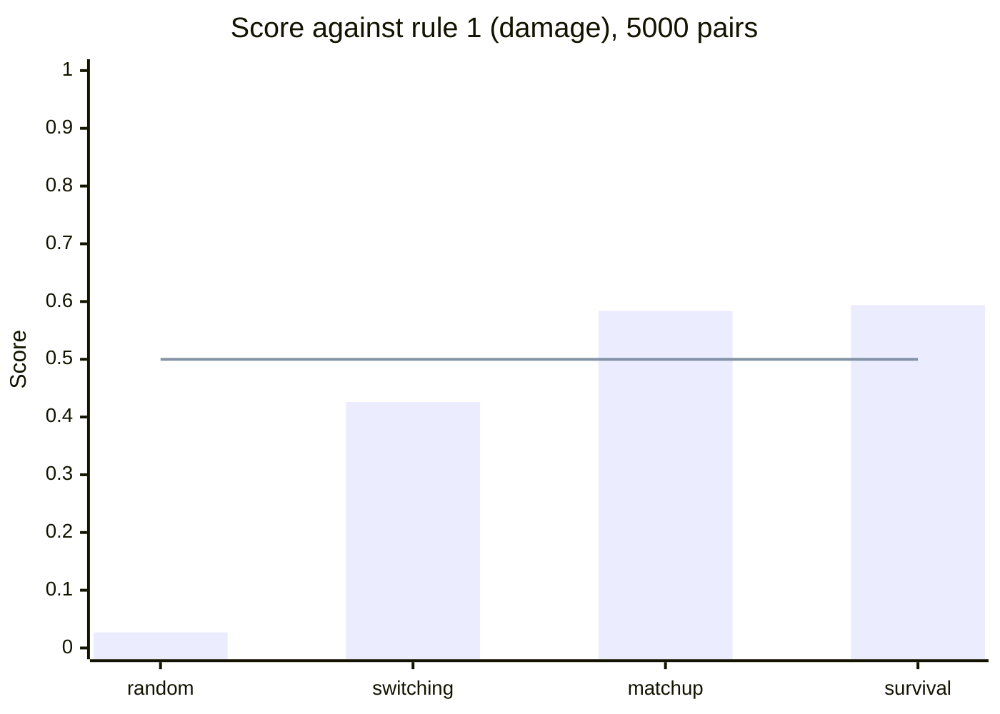
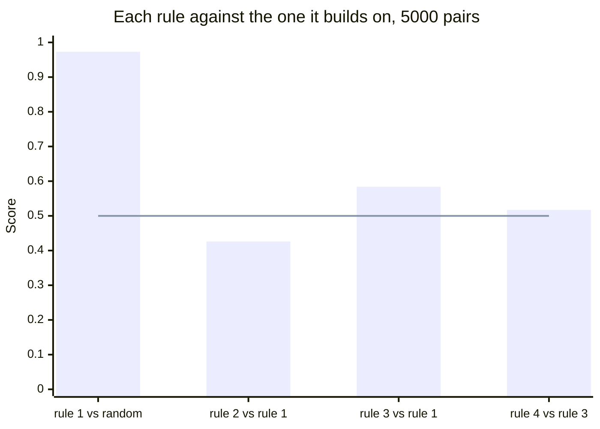

# TrainerLab AI

Bots that play the battle engine in [`../engine`](../engine), and the tools to
measure them. Everything here is Python, on top of a pybind11 binding of the
engine's flat C++ API.

## Quick start

Requirements: Python 3.11+, CMake ≥ 3.20 and a C++20 compiler (the install
compiles the engine and its binding).

```bash
cd ai
python -m venv .venv && source .venv/bin/activate
pip install -e ".[dev]"

pytest --cov                                  # every test, 100 % line and branch coverage required
trainerlab-play                               # play a battle against the best bot
trainerlab-tournament matchup damage          # rule 3 against rule 1, 500 pairs
```

## Playing in the terminal

```bash
trainerlab-play                                # random teams, against the best bot (rule 4)
trainerlab-play --opponent damage --seed 42    # choose the bot, replay a battle with its seed
trainerlab-play --team Dragapult,Snorlax,Toxapex,Excadrill,Blissey,Corviknight
trainerlab-play --speed fast --log battle.txt
```

Each turn clears the screen and draws framed panels: the board (both active
Pokémon with their types, status, stat stages and an HP bar that turns yellow
then red, your bench, what you have seen of the foe's team, the field), the
previous turn, and your moves, each damaging one tagged with its type
effectiveness on the foe (`x2`, `x1/2`, `x0`…). Type the number of your
choice, or `?` for the details of your moves: category, accuracy, priority
and what they do besides damage ("30% chance to paralyze the target").

`Switch…` opens a second menu with the Pokémon that can come in: their types,
HP and status, and how they take the foe's types ("weak to Fighting",
"immune to Ghost"). `0` goes back to the moves.

The turn's events are then typed out letter by letter, pausing longer on
knock-outs, critical hits and super effective hits. A summary closes the
battle: knock-outs on each side and your most decisive Pokémon.

| Option | Effect |
|---|---|
| `--speed instant\|fast\|normal\|slow` | how fast the history is typed (default: `normal`) |
| `--no-hints` | hides the type effectiveness tags, for players who prefer to work them out from the type chart |
| `--log FILE` | writes the whole battle to a file, without colours, to read or analyse later |
| `--no-color` | plain text |

You see exactly what the bots see: the same `observe` view, and the same
events. A seed replays the same battle, so a surprising loss can be studied
again.

## How it fits together

| Module | Role |
|---|---|
| `environment.py` | **The referee.** Owns the real battle state and enforces the rules: legal actions, turns, replacements in speed order, turn limit, winner. Also draws random legal teams. |
| `bots.py` | **The players.** Each bot picks among the options the referee offers, from its side's view only. |
| `battle.py` | **The game loop.** Asks each bot for its choices and hands them to the referee until the end. |
| `harness.py` | **The measurement.** Plays paired battles and computes a score with its confidence interval. |
| `decisions.py` | **The data.** Replays the battles of a tournament and gives every decision: what the bot saw, its options, its choice, and how the battle ended. |
| `estimate.py` | **The bots' mental model of damage**, built only from what a player can see. |
| `tournament.py` | **The command** `trainerlab-tournament`: the only place that knows every bot by name. |
| `human.py` | **You, as a bot.** The game loop asks you exactly what it asks any bot; a wrong key is asked again. |
| `render.py` | **The text.** Views, options and events turned into sentences, with colours in a terminal. |
| `screen.py` | **The terminal.** Framed panels, cleared screens and the typed-out history, with the log file. |
| `stats.py` | **The end-of-battle summary.** Knock-outs and damage dealt, credited to the Pokémon that attacked. |
| `play.py` | **The command** `trainerlab-play`. |
| `watch.py` | **The command** `trainerlab-watch`: replays a battle between two bots, with what each one saw and estimated. |

A bot never sees the real state: it receives `observe(side)`, which hides
the opponent's Pokémon that have not entered the field and the remaining
turns of sleep. A test spies on what the loop hands the bots to keep it that
way.

## Replaying every decision

The engine and the bots are deterministic, so two bots and a seed define a
pair of battles entirely. No battle is stored: `decisions` replays them, and
the same call always gives the same decisions.

```python
from trainerlab.decisions import decisions
from trainerlab.tournament import BOTS

for d in decisions(BOTS["survival"], BOTS["matchup"], seeds=range(20000, 21000)):
    d.view, d.legal, d.choice  # what the deciding side saw, its options, its choice
    d.side, d.by_a, d.turn  # who decided (bot A or bot B), and when
    d.outcome  # "win", "draw" or "loss", for the side that decided
```

The battles are exactly those a tournament with the same bots and seeds
measures: both run through one function that sets up a pair from its seed.
Decisions come battle by battle, so a long series streams instead of filling
the memory. A dataset is named by its bots, its seeds and the commit of the
code: if a bot changes, its battles change.

## Watching a battle between bots

```bash
trainerlab-watch survival matchup --losses --pairs 50 --first-seed 20000
trainerlab-watch survival matchup --seed 20004 --a-side 1 | less
```

The first command lists the battles bot A lost, each as the command that
replays it. The second replays one: at every decision, the bot's Pokémon
against the foe's, who moves first and the foe's best hit, then every option
with the bot's damage estimate and the one it chose (`>`); then the events of
the turn, as they really happened.

A mistake shows where the estimate and the events disagree: a move estimated
at 120 HP that does not affect the target, a Pokémon kept in that was
expected to survive. The battle is the one a tournament played, through the
same setup of a pair from its seed.

## Method

**Paired battles.** A pair is two battles with the same seed and the same two
teams, the bots swapping sides. Each bot plays both teams and both sides
under the same luck, so team strength and seed luck cancel out.

**Random teams.** Every pair draws its own two legal teams of six. A result
measured on one fixed matchup can be specific to it (see the traps below).

**Score.** Bot A's wins plus half its draws, over the games played, with a
95 % Wilson score interval. A bot is better only if the whole interval is
above 0.5.

**Choose, then confirm.** When several variants are compared, the choice is
made on seeds 0–499 and confirmed on unseen seeds 10000–10499. Where
possible, the variant is fixed before measuring at all.

## The bots

| Bot | Command name | Rule |
|---|---|---|
| `RandomBot` | `random` | A uniformly random legal choice: the baseline. |
| `HeuristicBot` | `damage` | **Rule 1.** Plays the move with the highest expected damage: power × STAB × type effectiveness × accuracy. |
| `SwitchingBot` | `switching` | **Rule 2.** Rule 1, but leaves a super effective threat for a Pokémon that resists it. |
| `MatchupBot` | `matchup` | **Rule 3.** Rule 1, but replaces a fainted Pokémon with the best matchup: damage it can deal minus damage it can take. |
| `SurvivalBot` | `survival` | **Rule 4.** Rule 3, but leaves a Pokémon the opponent would knock out before it acts, if it still has half its HP and a bench Pokémon loses at most a third of its HP to the hit. |

## Results

Every bot against every other, on random teams, **5000 pairs (10 000 battles)
per duel**, seeds 0–4999. Each cell is the score of the row's bot against the
column's bot; the whole interval is above 0.5 when the row's bot is better.

| Bot ↓ against → | random | damage (rule 1) | switching (rule 2) | matchup (rule 3) | survival (rule 4) |
|---|---|---|---|---|---|
| **random** | 0.499 | *0.027* | *0.075* | *0.027* | *0.025* |
| **damage** (rule 1) | 0.973 | 0.500 | *0.574* | *0.416* | *0.406* |
| **switching** (rule 2) | 0.925 | 0.426 | 0.500 | *0.370* | *0.363* |
| **matchup** (rule 3) | 0.973 | 0.584 | 0.630 | 0.500 | *0.483* |
| **survival** (rule 4) | **0.975** | **0.594** | **0.637** | **0.517** | 0.500 |

Cells in italics are not measured separately: each is one minus the measured
duel the other way round.





The measured duels, with their intervals:

| Duel | Score | 95 % interval | Record (W / D / L) |
|---|---|---|---|
| random vs random | 0.499 | [0.489, 0.509] | 4963 / 57 / 4980 |
| damage vs random | 0.973 | [0.970, 0.976] | 9728 / 5 / 267 |
| switching vs random | 0.925 | [0.919, 0.930] | 9236 / 23 / 741 |
| matchup vs random | 0.973 | [0.970, 0.976] | 9731 / 5 / 264 |
| survival vs random | 0.975 | [0.971, 0.978] | 9743 / 6 / 251 |
| switching vs damage | 0.426 | [0.416, 0.435] | 4235 / 43 / 5722 |
| matchup vs damage | 0.584 | [0.574, 0.593] | 5812 / 51 / 4137 |
| survival vs damage | 0.594 | [0.584, 0.603] | 5912 / 52 / 4036 |
| matchup vs switching | 0.630 | [0.621, 0.640] | 6281 / 43 / 3676 |
| survival vs switching | 0.637 | [0.627, 0.646] | 6345 / 45 / 3610 |
| survival vs matchup | 0.517 | [0.507, 0.527] | 5148 / 45 / 4807 |

Any line reproduces with `trainerlab-tournament <bot> <opponent> --pairs 5000`.

**What the table says.**

- **Rule 4 is the best bot**: it beats every other one, rule 3 included
  (0.517, the whole interval above 0.5).
- **Against the random bot, every rule looks alike** (about 0.97): the
  replacement rules of 3 and 4 only pay off against an opponent that plays
  well. Beating the random bot says little once a bot is reasonable.
- **Rule 2 is worse than rule 1 against everyone**, the random bot included.
- **The mirror duels give exactly 0.500, by construction**: a deterministic
  bot against itself plays the same battle twice in a pair, sides swapped, so
  every pair is one win and one loss, or two draws. They check that the
  harness is symmetric, not that the bots are balanced. Random against random,
  whose two bots differ, is the real sanity check: 0.499.

**How the rules were chosen.** Each decision was made earlier on 500 pairs
(seeds 0–499), then confirmed on unseen seeds (10000–10499), before these
5000-pair runs. Seeds 0–4999 include those first 500, so a tenth of these
battles were already seen when the rules were chosen.

### Negative results

**Rule 2 loses to rule 1** (0.426 [0.416, 0.435]). Switching out of a super
effective threat costs a turn, and the incoming Pokémon takes the hit. It is
kept in the code as a measured negative result.

**Rule 4 as first defined did not beat rule 3** (0.494 [0.464, 0.525], from
the version described in the commit that introduced rule 4). It
saved weakened Pokémon (median 36 % HP) at the cost of a hit on the
switch-in, whereas letting a doomed Pokémon faint gives a free switch-in.
Rule 4 above is the corrected version, fixed before being measured.

### Traps found on the way

**One matchup is not every matchup.** The first measurements used two fixed
teams. There, rule 2 beat rule 1 (0.874), and the best replacement formula
was "take the least damage". On random teams, rule 2 loses, and that formula
is the weakest of the three tried.

**Picking the best of several variants on the same data flatters it.** The
replacement formula of rule 3 was chosen before measuring; three
alternatives tried afterwards were checked on unseen seeds before any
conclusion.

**A tournament found a bug in the game loop.** A replacement can faint on
entry (Stealth Rock), so who must replace next can change, or the battle can
end. The loop now asks for one replacement at a time; two regression tests
replay the battles that exposed it.

## The damage model

`estimate.py` gives the bots a rough idea of damage in HP, from visible
information only: stats, stat stages, power, STAB, types, the common damage
and speed items, and remaining HP. It leaves out abilities, weather, critical
hits and the damage roll (it takes the average roll). On 2374 real hits, the
engine's damage divided by the estimate has a median of 1.00, and 75 % of
hits are within ±20 %.

## Known limitations

- Expected damage ignores abilities (Levitate, Volt Absorb…), multi-hit moves
  and fixed-damage moves (Seismic Toss), so the bots sometimes pick a useless
  move.
- Bots look one turn ahead at most, and never predict the opponent.
- The measured gap between rules 3 and 4 is about one point: real, but small.
