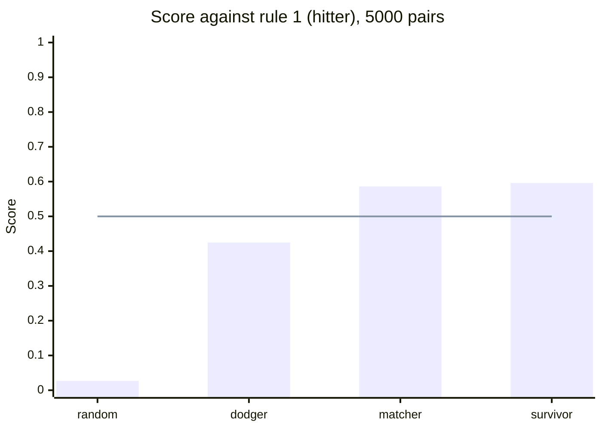
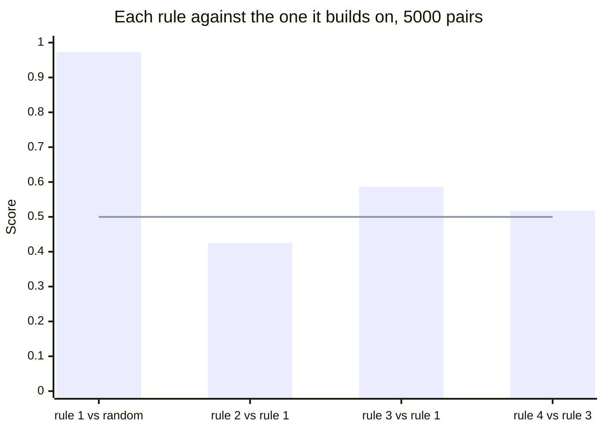

# TrainerLab AI

Bots that play the battle engine in [`../engine`](../engine), and the tools to
measure them. Everything here is Python, on top of a pybind11 binding of the
engine's flat C++ API.

## Quick start

Requirements: Python 3.11+, CMake ≥ 3.20 and a C++20 compiler (the install
compiles the engine and its binding).

```bash
cd ai
python -m venv .venv && source .venv/bin/activate
pip install -e ".[dev]"

pytest --cov                        # every test, 100 % line and branch coverage required
trainerlab                          # a menu: choose what to do, then each option
trainerlab play                     # play a battle against the best bot
trainerlab duel matcher hitter      # rule 3 against rule 1, 500 pairs
trainerlab bots                     # every bot and what it does
```

## One command

Everything goes through `trainerlab`. With no argument it opens a menu: the
mode (play, duel, watch, audit, dataset, train), then its options one at a time,
each with a default that Enter keeps. Before running, it prints the same
command in one line:

```
How many pairs of battles (two battles each, sides swapped) [500] > 5000

Seed of the first pair [0] > 30000

trainerlab duel calculator survivor --pairs 5000 --from 30000
```

That line runs directly, with no question: it is the form used in scripts
and throughout this README. `trainerlab --help` lists the commands,
`trainerlab duel --help` the options of one. Every command that plays
several battles takes `--pairs N`, the number of pairs (two battles each),
and `--from SEED`, the seed of the first pair: the pairs use the seeds that
follow, one each, so `--pairs 5000 --from 30000` plays seeds 30000 to 34999.

`duel` and `dataset` spread the pairs over every core of the machine, each
process playing a block of consecutive seeds. A pair depends on its seed
alone, so the results are the same whatever the number of processes (a test
checks it); `--jobs N` sets that number, `--jobs 1` plays on one core.
In a terminal, a line shows the pairs played and the time left at the
current pace (`1250/5000 pairs (25 %), about 4 min 10 s left`); it stays out
of pipes and log files.

## Playing in the terminal

```bash
trainerlab play                               # random teams, against survivor (rule 4)
trainerlab play --against hitter --seed 42    # choose the bot, replay a battle with its seed
trainerlab play --team Dragapult,Snorlax,Toxapex,Excadrill,Blissey,Corviknight
trainerlab play --speed fast --log battle.txt
```

Each turn clears the screen and draws framed panels: the board (both active
Pokémon with their types, status, stat stages and an HP bar that turns yellow
then red, your bench, what you have seen of the foe's team, the field), the
previous turn, and your moves, each damaging one tagged with its type
effectiveness on the foe (`x2`, `x1/2`, `x0`…). Type the number of your
choice, or `?` for the details of your moves: category, accuracy, priority
and what they do besides damage ("30% chance to paralyze the target").

`Switch…` opens a second menu with the Pokémon that can come in: their types,
HP and status, and how they take the foe's types ("weak to Fighting",
"immune to Ghost"). `0` goes back to the moves.

The turn's events are then typed out letter by letter, pausing longer on
knock-outs, critical hits and super effective hits. A summary closes the
battle: knock-outs on each side and your most decisive Pokémon.

| Option | Effect |
|---|---|
| `--speed instant\|fast\|normal\|slow` | how fast the history is typed (default: `normal`) |
| `--no-hints` | hides the type effectiveness tags, for players who prefer to work them out from the type chart |
| `--log FILE` | writes the whole battle to a file, without colours, to read or analyse later |
| `--no-color` | plain text |

You see exactly what the bots see: the same `observe` view, and the same
events. A seed replays the same battle, so a surprising loss can be studied
again.

## How it fits together

| Module | Role |
|---|---|
| `environment.py` | **The referee.** Owns the real battle state and enforces the rules: legal actions, turns, replacements in speed order, turn limit, winner. Also draws random legal teams. |
| `bots.py` | **The players.** Each bot picks among the options the referee offers, from its side's view only. |
| `battle.py` | **The game loop.** Asks each bot for its choices and hands them to the referee until the end. |
| `harness.py` | **The measurement.** Plays paired battles and computes a score with its confidence interval. |
| `decisions.py` | **The data.** Replays the battles of a tournament and gives every decision: what the bot saw, its options, its choice, and how the battle ended. |
| `estimate.py` | **The bots' mental model of damage**, built only from what a player can see. |
| `roster.py` | **Every bot by name**: the only place that knows them all. |
| `cli.py` | **The command** `trainerlab`: the menu, and the dispatch to each mode below. |
| `duel.py` | **`trainerlab duel`**: one bot against another, over paired battles. |
| `human.py` | **You, as a bot.** The game loop asks you exactly what it asks any bot; a wrong key is asked again. |
| `render.py` | **The text.** Views, options and events turned into sentences, with colours in a terminal. |
| `screen.py` | **The terminal.** Framed panels, cleared screens and the typed-out history, with the log file. |
| `stats.py` | **The end-of-battle summary.** Knock-outs and damage dealt, credited to the Pokémon that attacked. |
| `play.py` | **`trainerlab play`**. |
| `watch.py` | **`trainerlab watch`**: replays a battle between two bots, with what each one saw and estimated. |
| `audit.py` | **`trainerlab audit`**: counts the mistakes of a bot that a program can spot on its own. |
| `dataset.py` | **`trainerlab dataset`**: turns the decisions of a series of battles into features and labels, in a `.npz` file. |
| `features.py` | **What a side sees, as numbers**: the features of a position, for the dataset and for rule 6. |
| `forecaster.py` | **Rule 6**: plays each option a turn ahead and keeps what the model rates best. Ships with its model, `models/win-logistic.npz`. |
| `model.py` | **The win probability model**: a logistic regression or a small neural network, in numpy, with its training and its scores. |
| `train.py` | **`trainerlab train`**: fits a model on a dataset and measures it on battles it has never seen. |

A bot never sees the real state: it receives `observe(side)`, which hides
the opponent's Pokémon that have not entered the field and the remaining
turns of sleep. A test spies on what the loop hands the bots to keep it that
way.

## Replaying every decision

The engine and the bots are deterministic, so two bots and a seed define a
pair of battles entirely. No battle is stored: `decisions` replays them, and
the same call always gives the same decisions.

```python
from trainerlab.decisions import decisions
from trainerlab.roster import BOTS

for d in decisions(BOTS["survivor"], BOTS["matcher"], seeds=range(20000, 21000)):
    d.view, d.legal, d.choice  # what the deciding side saw, its options, its choice
    d.side, d.by_a, d.turn  # who decided (bot A or bot B), and when
    d.outcome  # "win", "draw" or "loss", for the side that decided
```

The battles are exactly those a tournament with the same bots and seeds
measures: both run through one function that sets up a pair from its seed.
Decisions come battle by battle, so a long series streams instead of filling
the memory. A dataset is named by its bots, its seeds and the commit of the
code: if a bot changes, its battles change.

## Building a dataset

```bash
trainerlab dataset calculator survivor --pairs 2000 --from 40000   # -> calculator-vs-survivor-40000-41999.npz
```

Every decision of both bots becomes one row. **The features** describe what
the deciding side saw, from its point of view (`my_…` against `foe_…`), 249
numbers between 0 and 1 (stat stages between −1 and 1):

| Group | Features |
|---|---|
| Each active | HP share, status, the seven stat stages, its species (one-hot) |
| Each team | Pokémon alive, total HP, Pokémon not yet seen, the HP share of each species seen |
| Each side of the field | Stealth Rock, Spikes, Toxic Spikes, Aurora Veil |
| The field | weather, terrain, turn |
| The engine | the highest damage each active can expect against the other (`expected_damage`), as a share of the target's HP; who is faster |
| The decision | a replacement or a turn's action |

A foe Pokémon not yet seen is counted as alive at full HP, which it is,
without its species. **The label** `y` is the score of the battle for the
side that decided: 1 for a win, 0.5 for a draw, 0 for a loss.

The file also holds, for each row, its `seed`, `side`, `a_side` and `turn`,
then `feature_names`, the two `bots` and the `catalog_fingerprint`. The rows
of one battle share their label and follow each other closely: **a split
between training and test goes by seed, never by row**, or the test measures
battles already seen.

The command above gives 185 402 rows from 4000 battles in three minutes,
5.6 MB compressed (48.4 % won rows, 0.5 % drawn: the loser of a battle makes
a few more decisions, one replacement per Pokémon lost). Seeds 40000 and up
served for nothing else. Like the decisions, the file is not stored: the
command rebuilds it identically from the same code. Two different bots are
needed: a deterministic bot against itself plays every battle of a pair
twice, mirrored, so every row would come twice.

## The win probability model

```bash
trainerlab train calculator-vs-survivor-40000-41999.npz                    # logistic regression
trainerlab train calculator-vs-survivor-40000-41999.npz --model network    # one hidden layer
```

The model reads the features of a position and gives the probability that
the side to play wins. It is written with numpy alone: layers of ReLU units,
then a sigmoid; with no hidden layer it is exactly a logistic regression.
Training minimises the cross-entropy against the label (1, 0.5, 0) by
minibatch gradient descent (Adam), from a fixed seed: the same dataset
always gives the same model.

**Method.** The battles whose seed is a multiple of 5 are held out: 20 % of
the battles, never seen in training, and no battle is split between the two
sets. Both models were fixed before any measurement and measured once: a
logistic regression, and a network with one hidden layer of 64 units, both
10 passes over the data, batches of 1024, learning rate 0.001, L2 decay
0.0001. The reference is a constant, the share of wins in training.

On the dataset above (147 356 rows from 1600 pairs, 3200 battles, to train;
38 046 rows from 400 pairs to test):

| Model | Log loss (test) | Brier (test) | Accuracy (test) | Log loss (train) |
|---|---|---|---|---|
| constant | 0.693 | 0.248 | 0.513 | |
| logistic regression | **0.532** | **0.178** | **0.723** | 0.507 |
| network, 64 hidden units | 0.632 | 0.206 | 0.699 | 0.351 |

Log loss and Brier score: lower is better, 0.693 and 0.25 for a coin toss.
Accuracy: rows won or lost on the right side of 0.5, draws left out.

**What the table says.**

- **The logistic regression predicts the winner of an unseen position
  72 % of the time**, against 51 % for the constant, and its scores in
  training and in test are close: it generalises.
- **The network overfits.** It does much better than the logistic
  regression on the battles it was trained on (0.351) and worse on the
  others (0.632). Rows of one battle look alike and share their label, and
  the species features let it recognise a battle rather than a position:
  3200 battles are few for 16 000 weights. It was measured as fixed in
  advance; making it generalise (stopping early, on a validation set taken
  from the training seeds) would be a new variant, to choose without the
  test seeds and confirm on them.
- **The weights of the logistic regression make sense.** The largest, on
  standardised features: Pokémon alive and total HP of each side (the foe's
  with a minus sign), then the best damage each active can expect, then the
  HP of a few species (Dragapult, Azumarill, Mega Gengar).

## Rule 6: a turn ahead, rated by the model

Rule 6 is the first bot that learned something. At each decision, for each
of its options, it plays the turn on a copy of what it sees and asks the win
probability model how likely it is to win from the position reached, then
keeps the best option:

- **The foe is assumed to play as rule 5** (`calculator`), worked out from
  the foe's own view of the copy.
- **Two turns per option**, on the same two seeds for every option, so that
  options are compared under the same luck.
- **A foe Pokémon not yet seen** has to be somewhere for the engine to play
  the turn: it is filled with a copy of the foe's active, still unseen, and
  the view the model reads hides it again.
- **The model** is the logistic regression measured above, shipped with the
  package (`ai/src/trainerlab/models/win-logistic.npz`). It is rebuilt with
  the two commands of the previous section (`--out` to put it there).

Fixed before measuring, measured once on seeds that served for nothing else:

```bash
trainerlab duel forecaster calculator --pairs 5000 --from 50000
```

| Duel | Score | 95 % interval | Record (W / D / L) |
|---|---|---|---|
| forecaster (rule 6) vs calculator (rule 5) | **0.844** | [0.837, 0.851] | 8430 / 17 / 1553 |

**Rule 6 beats rule 5 by 34 points**, the largest step so far. 5000 pairs
take 37 minutes, against a minute and a half for rule 5.

**But this duel flatters it.** Rule 6 assumes the foe plays as rule 5, and
rule 5 is deterministic: against `calculator`, rule 6 knows the foe's move
before choosing its own, every turn. Part of the gain is that knowledge, not
the model. Against a bot that plays otherwise, the assumption is wrong; that
duel, not measured yet, is what tells how much of the 34 points the model
earns on its own.

## Rule 7: the foe's best reply

Rule 6 assumes the foe plays as rule 5. Rule 7 assumes nothing: for each of
its options, it plays the turn against every reply of the foe (its moves,
and its switches to Pokémon already seen), and rates the option by the
worst odds those replies leave it. It keeps the option whose worst case is
best: minimax, one turn deep. An option is dropped as soon as one reply puts
it below the best option so far, since its worst case can only be lower.

It is more cautious, and about six times slower. Fixed before measuring;
to be measured on seeds no bot was chosen on:

```bash
trainerlab duel strategist forecaster --pairs 5000 --from 70000
trainerlab duel strategist calculator --pairs 5000 --from 50000   # as forecaster, to compare
trainerlab duel strategist survivor --pairs 5000 --from 55000
```

## Another model for the forecaster

Any command that takes a bot also takes `forecaster:MODEL.npz` (or
`strategist:MODEL.npz`): rules 6 and 7 playing with the model in that file
instead of the shipped one. In the menu, choosing either asks for the model (Enter keeps the shipped one).
`trainerlab train` takes several datasets and puts them together, so a new
model can learn from the positions rule 6 itself reaches:

```bash
trainerlab dataset forecaster calculator --pairs 2000 --from 60000
trainerlab dataset forecaster survivor --pairs 2000 --from 62000
trainerlab train calculator-vs-survivor-40000-41999.npz \
  forecaster-vs-calculator-60000-61999.npz forecaster-vs-survivor-62000-63999.npz --out gen2.npz
trainerlab duel forecaster:gen2.npz forecaster --pairs 5000 --from 65000
```

The last line measures the new model against the shipped one, on seeds no
dataset used. The two bots differ only by their model, so the score is what
the new data is worth.

## Watching a battle between bots

```bash
trainerlab watch survivor matcher --losses --pairs 50 --from 20000
trainerlab watch survivor matcher --seed 20004 --side 1 | less
```

The first command lists the battles bot A lost, each as the command that
replays it. The second replays one: at every decision, the bot's Pokémon
against the foe's, who moves first and the foe's best hit, then every option
with the bot's damage estimate and the one it chose (`>`); then the events of
the turn, as they really happened.

A mistake shows where the estimate and the events disagree: a move estimated
at 120 HP that does not affect the target, a Pokémon kept in that was
expected to survive. The battle is the one a tournament played, through the
same setup of a pair from its seed.

## Method

**Paired battles.** A pair is two battles with the same seed and the same two
teams, the bots swapping sides. Each bot plays both teams and both sides
under the same luck, so team strength and seed luck cancel out.

**Random teams.** Every pair draws its own two legal teams of six. A result
measured on one fixed matchup can be specific to it (see the traps below).

**Score.** Bot A's wins plus half its draws, over the games played, with a
95 % Wilson score interval. A bot is better only if the whole interval is
above 0.5.

**Choose, then confirm.** When several variants are compared, the choice is
made on seeds 0–499 and confirmed on unseen seeds 10000–10499. Where
possible, the variant is fixed before measuring at all.

## The bots

| Bot | Command name | Rule |
|---|---|---|
| `RandomBot` | `random` | A uniformly random legal choice: the baseline. |
| `HeuristicBot` | `hitter` | **Rule 1.** Plays the move with the highest expected damage: power × STAB × type effectiveness × accuracy. |
| `SwitchingBot` | `dodger` | **Rule 2.** Rule 1, but leaves a super effective threat for a Pokémon that resists it. |
| `MatchupBot` | `matcher` | **Rule 3.** Rule 1, but replaces a fainted Pokémon with the best matchup: damage it can deal minus damage it can take. |
| `SurvivalBot` | `survivor` | **Rule 4.** Rule 3, but leaves a Pokémon the opponent would knock out before it acts, if it still has half its HP and a bench Pokémon loses at most a third of its HP to the hit. |
| `StrategistBot` | `strategist` | **Rule 7.** Rule 6, but without guessing the foe: each option is rated by the foe's best reply, the one that leaves it the lowest odds (minimax, one turn deep). |
| `ForecastBot` | `forecaster` | **Rule 6.** For each option, plays the turn on a copy of what it sees, the foe playing what rule 5 would, then keeps the option whose position the win probability model rates best (the logistic regression below). A replacement is chosen the same way, without a turn. |
| `OutlookBot` | `calculator` | **Rule 5.** Rule 4, but plays the move with the highest damage expected by the engine itself (`expected_damage`, its mean), instead of power × STAB × type effectiveness × accuracy. Escapes and replacements are rule 4's. |

## Results

Every bot against every other, on random teams, **5000 pairs (10 000 battles)
per duel**, seeds 0–4999. Each cell is the score of the row's bot against the
column's bot; the whole interval is above 0.5 when the row's bot is better.

| Bot ↓ against → | random | hitter (rule 1) | dodger (rule 2) | matcher (rule 3) | survivor (rule 4) |
|---|---|---|---|---|---|
| **random** | 0.500 | *0.027* | *0.076* | *0.026* | *0.025* |
| **hitter** (rule 1) | 0.973 | 0.500 | *0.575* | *0.414* | *0.404* |
| **dodger** (rule 2) | 0.924 | 0.425 | 0.500 | *0.368* | *0.361* |
| **matcher** (rule 3) | 0.974 | 0.586 | 0.632 | 0.500 | *0.483* |
| **survivor** (rule 4) | **0.975** | **0.596** | **0.639** | **0.517** | 0.500 |

Cells in italics are not measured separately: each is one minus the measured
duel the other way round.





The measured duels, with their intervals:

| Duel | Score | 95 % interval | Record (W / D / L) |
|---|---|---|---|
| random vs random | 0.500 | [0.490, 0.510] | 4969 / 58 / 4973 |
| hitter vs random | 0.973 | [0.970, 0.976] | 9732 / 5 / 263 |
| dodger vs random | 0.924 | [0.919, 0.929] | 9232 / 23 / 745 |
| matcher vs random | 0.974 | [0.970, 0.977] | 9733 / 6 / 261 |
| survivor vs random | 0.975 | [0.971, 0.977] | 9742 / 7 / 251 |
| dodger vs hitter | 0.425 | [0.415, 0.435] | 4228 / 44 / 5728 |
| matcher vs hitter | 0.586 | [0.576, 0.596] | 5837 / 49 / 4114 |
| survivor vs hitter | 0.596 | [0.587, 0.606] | 5938 / 52 / 4010 |
| matcher vs dodger | 0.632 | [0.623, 0.642] | 6302 / 42 / 3656 |
| survivor vs dodger | 0.639 | [0.629, 0.648] | 6364 / 44 / 3592 |
| survivor vs matcher | 0.517 | [0.507, 0.527] | 5148 / 43 / 4809 |

Any line reproduces with `trainerlab duel <bot> <opponent> --pairs 5000`.

**What the table says.**

- **Rule 4 is the best bot**: it beats every other one, rule 3 included
  (0.517, the whole interval above 0.5).
- **Against the random bot, every rule looks alike** (about 0.97): the
  replacement rules of 3 and 4 only pay off against an opponent that plays
  well. Beating the random bot says little once a bot is reasonable.
- **Rule 2 is worse than rule 1 against everyone**, the random bot included.
- **The mirror duels give exactly 0.500, by construction**: a deterministic
  bot against itself plays the same battle twice in a pair, sides swapped, so
  every pair is one win and one loss, or two draws. They check that the
  harness is symmetric, not that the bots are balanced. Random against random,
  whose two bots differ, is the real sanity check: 0.500.

**How the rules were chosen.** Each decision was made earlier on 500 pairs
(seeds 0–499), then confirmed on unseen seeds (10000–10499), before these
5000-pair runs. Seeds 0–4999 include those first 500, so a tenth of these
battles were already seen when the rules were chosen.

### Negative results

**Rule 2 loses to rule 1** (0.425 [0.415, 0.435]). Switching out of a super
effective threat costs a turn, and the incoming Pokémon takes the hit. It is
kept in the code as a measured negative result.

**Rule 4 as first defined did not beat rule 3** (0.494 [0.464, 0.525], from
the version described in the commit that introduced rule 4). It
saved weakened Pokémon (median 36 % HP) at the cost of a hit on the
switch-in, whereas letting a doomed Pokémon faint gives a free switch-in.
Rule 4 above is the corrected version, fixed before being measured.

### Traps found on the way

**One matchup is not every matchup.** The first measurements used two fixed
teams. There, rule 2 beat rule 1 (0.874), and the best replacement formula
was "take the least damage". On random teams, rule 2 loses, and that formula
is the weakest of the three tried.

**Picking the best of several variants on the same data flatters it.** The
replacement formula of rule 3 was chosen before measuring; three
alternatives tried afterwards were checked on unseen seeds before any
conclusion.

**A tournament found a bug in the game loop.** A replacement can faint on
entry (Stealth Rock), so who must replace next can change, or the battle can
end. The loop now asks for one replacement at a time; two regression tests
replay the battles that exposed it.

## Error analysis

Why does the best bot lose? Rule 4's losses against rule 3 were studied one by
one, then the mistakes a program can spot were counted over many battles.
Seeds 20000 and up: none of them served to choose or measure a rule.

### By hand: 15 losses

`trainerlab watch survivor matcher --losses --pairs 50 --from 20000` lists the
losses; each was replayed with `trainerlab watch`, which shows at every
decision the bot's estimate of each option, then what really happened.

**The convention.** A loss often holds several mistakes. Its category is the
**last decision after which bot A could no longer win** except by luck; the
other mistakes are kept alongside. A piece of bad luck is the cause only if
the battle was lost for good after it. A loss with no such decision in its
last turns is `outclassed`: the foe's remaining team was simply stronger.

Every loss is in [`analysis/rule4-losses.csv`](analysis/rule4-losses.csv),
with the turn and what would have won.

| Family | Categories | Losses | With the mistakes kept alongside |
|---|---|---|---|
| **Wrong damage estimate** | `move-mechanics`: fixed damage, multi-hit moves, moves that fail | **5** | 7, plus 3 `ability-ignored` |
| Who acts first ignored | `priority-ignored`, `replacement-ignores-speed` | 2 | 3 |
| No plan beyond one turn | `status-never-used`, `opponent-state-ignored` | 2 | 2 |
| Bad luck | `bad-luck` | 1 | 4 |
| No mistake in the endgame | `outclassed` | 5 | |

Of the 10 losses a bot decision caused, **half come from a wrong damage
estimate**: Blissey never plays Seismic Toss (fixed damage, estimated at 0),
Triple Axel is estimated as one hit of 20 power, Poltergeist is played on a
foe with no item and fails. The losses where bot A led at some point are the
ones decided by a mistake; those where it never led are mostly
`outclassed`.

**A rejected hypothesis.** In 22 of the 50 losses listed, bot A never led and
lost the first Pokémon, often on turn 1. Losing the opening matchup (the two
leads are not chosen) looked like a cause. In the 4 battles checked, the foe
lost its lead on turn 2 every time: openings are even trades, and these
battles are decided later.

**A bug found on the way.** In one loss, a Pokémon pulled in by Emergency
Exit used, that same turn, the move its predecessor had chosen. The engine
now leaves a Pokémon that enters mid-turn without an action, as in the games;
every duel was measured again after the fix (the scores above).

### Automatically: 2000 battles

Some of these mistakes leave a trace that needs no judgement.
`trainerlab audit` counts them over bot A's decisions:

```bash
trainerlab audit survivor matcher --pairs 1000 --from 20000
```

| Check | What it spots | Per 1000 decisions | In lost battles | In won battles |
|---|---|---|---|---|
| `blind-choice` | a move played while every move is estimated at 0 damage | 143.5 | 37.1 % | 27.0 % |
| `failed` | a move that fails outright (Fake Out after the first turn, hazards already laid, a burn on a burned foe…) | 62.8 | 43.6 % | 26.4 % |
| `no-effect` | a move into an immunity, of type or of ability (Levitate…) | 37.1 | 25.3 % | 13.8 % |
| `fixed-damage-ko-missed` | Seismic Toss would knock out, a weaker choice is made | 4.4 | 4.0 % | 2.0 % |

2000 battles: 1025 won, 18 drawn, 957 lost; 49 716 decisions by rule 4.

- **One decision in seven is made blind**, every move estimated at zero: the
  bot then plays the first one in its list. One in ten is a move that fails
  or has no effect.
- **Every mistake is more frequent in lost battles**, 1.5 to 2 times. Lost
  and won battles are as long (25.0 and 24.8 decisions on average), so it is
  not a matter of more chances to err. It is an association: a mistake can
  also be the symptom of a lost position.
- Each check is tested on the mistakes found by hand: it must find them
  (20042-0, 20048-0, 20013-1…), and stay silent on look-alikes, such as a
  hit taken by Disguise, which is no immunity.

**What came next.** The first family called for a damage estimate computed
by the engine itself, which knows abilities, fixed damage, multi-hit moves
and the conditions under which a move fails, rather than a second, rougher
model of it in Python: that is rule 5, below.

## Rule 5: the damage the engine expects

The engine now answers one question for any move:
`_engine.expected_damage(view, side, slot)` gives the minimum, maximum and
mean HP the move would take from the opposing active, by playing it through
its own rules over every outcome of the dice (see the engine README, section
6). Rule 5 is rule 4 with one change: among its moves, it plays the highest
mean. A move into Levitate, Seismic Toss, a second Fake Out, Poltergeist on a
foe with no item or three hits of Triple Axel are now worth what they are
really worth.

The rule was fixed before measuring, and measured once, on seeds that served
to choose nothing (30000–34999):

```bash
trainerlab duel calculator survivor --pairs 5000 --from 30000
```

| Duel | Score | 95 % interval | Record (W / D / L) |
|---|---|---|---|
| calculator (rule 5) vs survivor (rule 4) | **0.631** | [0.621, 0.640] | 6289 / 37 / 3674 |

**Rule 5 beats rule 4 by thirteen points**, more than any step since rule 1
against the random bot (rule 3 gained 8.6 points on rule 1, rule 4 1.7 on
rule 3). The error analysis pointed there: half the losses a decision
caused came from a wrong damage estimate. Rule 5 is measured against rule 4
only, not yet against every other bot.

## The damage model

`estimate.py` gives the bots a rough idea of damage in HP, from visible
information only: stats, stat stages, power, STAB, types, the common damage
and speed items, and remaining HP. It leaves out abilities, weather, critical
hits and the damage roll (it takes the average roll). On 2374 real hits, the
engine's damage divided by the estimate has a median of 1.00, and 75 % of
hits are within ±20 %.

## Known limitations

- Rules 1 to 4 score a move by power × STAB × type effectiveness × accuracy,
  which ignores abilities (Levitate, Volt Absorb…), multi-hit moves and
  fixed-damage moves (Seismic Toss): one decision in ten fails or has no
  effect (see Error analysis). Rule 5 asks the engine instead, for its move
  choice only: its escapes and replacements still use these estimates.
- Bots look one turn ahead at most, and never predict the opponent.
- The measured gap between rules 3 and 4 is about one point: real, but small.
