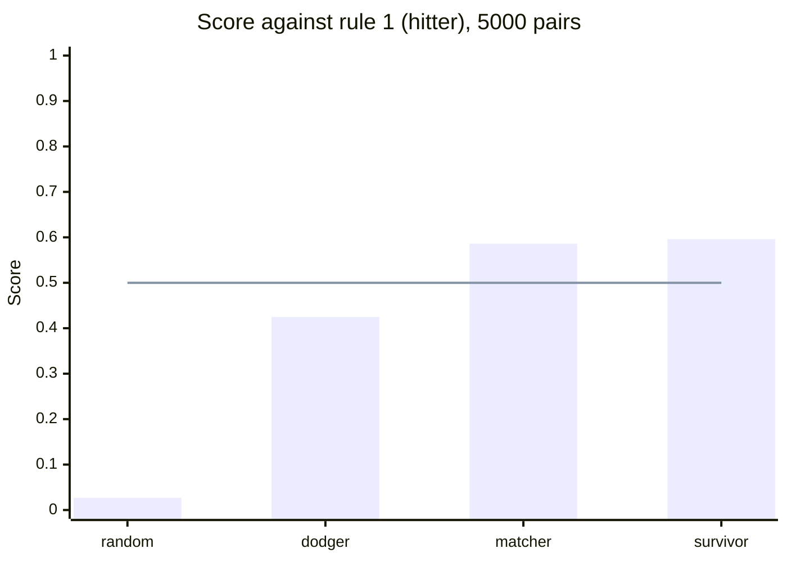
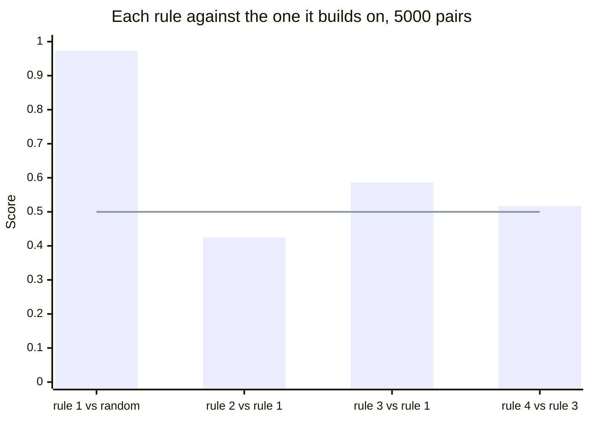

# Results

Every line is a score over **5000 pairs of battles (10 000 battles)** on
random teams, with its 95 % Wilson interval, reproducible with the command
above its table. Since the engine is compiled without fused multiply-add
(see the engine README), each line gives the same record, battle for
battle, on macOS and on Linux.

## Rules 1 to 4

Every bot against every other, seeds 0–4999. Each cell is the score of the row's bot against the
column's bot; the whole interval is above 0.5 when the row's bot is better.

| Bot ↓ against → | random | hitter (rule 1) | dodger (rule 2) | matcher (rule 3) | survivor (rule 4) |
|---|---|---|---|---|---|
| **random** | 0.500 | *0.027* | *0.076* | *0.026* | *0.025* |
| **hitter** (rule 1) | 0.973 | 0.500 | *0.575* | *0.414* | *0.404* |
| **dodger** (rule 2) | 0.924 | 0.425 | 0.500 | *0.368* | *0.361* |
| **matcher** (rule 3) | 0.974 | 0.586 | 0.632 | 0.500 | *0.483* |
| **survivor** (rule 4) | **0.975** | **0.596** | **0.639** | **0.517** | 0.500 |

Cells in italics are not measured separately: each is one minus the measured
duel the other way round.





The measured duels, with their intervals:

| Duel | Score | 95 % interval | Record (W / D / L) |
|---|---|---|---|
| random vs random | 0.500 | [0.490, 0.510] | 4969 / 58 / 4973 |
| hitter vs random | 0.973 | [0.970, 0.976] | 9732 / 5 / 263 |
| dodger vs random | 0.924 | [0.919, 0.929] | 9232 / 23 / 745 |
| matcher vs random | 0.974 | [0.970, 0.977] | 9733 / 6 / 261 |
| survivor vs random | 0.975 | [0.971, 0.977] | 9742 / 7 / 251 |
| dodger vs hitter | 0.425 | [0.415, 0.435] | 4228 / 44 / 5728 |
| matcher vs hitter | 0.586 | [0.576, 0.596] | 5837 / 49 / 4114 |
| survivor vs hitter | 0.596 | [0.587, 0.606] | 5938 / 52 / 4010 |
| matcher vs dodger | 0.632 | [0.623, 0.642] | 6302 / 42 / 3656 |
| survivor vs dodger | 0.639 | [0.629, 0.648] | 6364 / 44 / 3592 |
| survivor vs matcher | 0.517 | [0.507, 0.527] | 5148 / 43 / 4809 |

Any line reproduces with `trainerlab duel <bot> <opponent> --pairs 5000`.

**What the table says.**

- **Rule 4 is the best of these four rules**: it beats every other one, rule 3 included
  (0.517, the whole interval above 0.5).
- **Against the random bot, every rule looks alike** (about 0.97): the
  replacement rules of 3 and 4 only pay off against an opponent that plays
  well. Beating the random bot says little once a bot is reasonable.
- **Rule 2 is worse than rule 1 against everyone**, the random bot included.
- **The mirror duels give exactly 0.500, by construction**: a deterministic
  bot against itself plays the same battle twice in a pair, sides swapped, so
  every pair is one win and one loss, or two draws. They check that the
  harness is symmetric, not that the bots are balanced. Random against random,
  whose two bots differ, is the real sanity check: 0.500.

**How the rules were chosen.** Each decision was made earlier on 500 pairs
(seeds 0–499), then confirmed on unseen seeds (10000–10499), before these
5000-pair runs. Seeds 0–4999 include those first 500, so a tenth of these
battles were already seen when the rules were chosen.

### Negative results

**Rule 2 loses to rule 1** (0.425 [0.415, 0.435]). Switching out of a super
effective threat costs a turn, and the incoming Pokémon takes the hit. It is
kept in the code as a measured negative result.

**Rule 4 as first defined did not beat rule 3** (0.494 [0.464, 0.525], from
the version described in the commit that introduced rule 4). It
saved weakened Pokémon (median 36 % HP) at the cost of a hit on the
switch-in, whereas letting a doomed Pokémon faint gives a free switch-in.
Rule 4 above is the corrected version, fixed before being measured.

### Traps found on the way

**One matchup is not every matchup.** The first measurements used two fixed
teams. There, rule 2 beat rule 1 (0.874), and the best replacement formula
was "take the least damage". On random teams, rule 2 loses, and that formula
is the weakest of the three tried.

**Picking the best of several variants on the same data flatters it.** The
replacement formula of rule 3 was chosen before measuring; three
alternatives tried afterwards were checked on unseen seeds before any
conclusion.

**A tournament found a bug in the game loop.** A replacement can faint on
entry (Stealth Rock), so who must replace next can change, or the battle can
end. The loop now asks for one replacement at a time; two regression tests
replay the battles that exposed it.

## Rule 5: the damage the engine expects

The engine now answers one question for any move:
`_engine.expected_damage(view, side, slot)` gives the minimum, maximum and
mean HP the move would take from the opposing active, by playing it through
its own rules over every outcome of the dice (see the engine's [`docs/api.md`](../engine/docs/api.md)). Rule 5 is rule 4
with one change: among its moves, it plays the highest mean. A move into Levitate, Seismic Toss, a second Fake Out, Poltergeist on a
foe with no item or three hits of Triple Axel are now worth what they are
really worth.

The rule was fixed before measuring, and measured once, on seeds that served
to choose nothing (30000–34999):

```bash
trainerlab duel calculator survivor --pairs 5000 --from 30000
```

| Duel | Score | 95 % interval | Record (W / D / L) |
|---|---|---|---|
| calculator (rule 5) vs survivor (rule 4) | **0.631** | [0.621, 0.640] | 6289 / 37 / 3674 |

**Rule 5 beats rule 4 by thirteen points**, more than any step since rule 1
against the random bot (rule 3 gained 8.6 points on rule 1, rule 4 1.7 on
rule 3). The error analysis pointed there: half the losses a decision
caused came from a wrong damage estimate
([`error-analysis.md`](error-analysis.md)).

## Rule 5 and rule 6 against every other bot

```bash
trainerlab duel calculator <bot> --pairs 5000 --from 55000
trainerlab duel forecaster <bot> --pairs 5000 --from 55000   # --from 50000 against calculator
```

| Bot ↓ against → | calculator | survivor | matcher | hitter | dodger | random |
|---|---|---|---|---|---|---|
| **forecaster** (rule 6) | **0.844** [0.837, 0.851] | **0.859** [0.852, 0.866] | **0.864** [0.858, 0.871] | **0.887** [0.880, 0.893] | **0.894** [0.888, 0.900] | 0.985 [0.982, 0.987] |
| **calculator** (rule 5) | | 0.631 [0.621, 0.640] | 0.652 [0.642, 0.661] | 0.730 [0.721, 0.739] | 0.774 [0.765, 0.782] | **0.990** [0.988, 0.992] |

`calculator` against `survivor` is on seeds 30000–34999, the others on
55000–59999.

| Duel | Record (W / D / L) |
|---|---|
| forecaster vs calculator | 8430 / 17 / 1553 |
| forecaster vs survivor | 8580 / 27 / 1393 |
| forecaster vs matcher | 8630 / 28 / 1342 |
| forecaster vs hitter | 8857 / 17 / 1126 |
| forecaster vs dodger | 8924 / 28 / 1048 |
| forecaster vs random | 9845 / 7 / 148 |
| calculator vs survivor | 6289 / 37 / 3674 |
| calculator vs matcher | 6498 / 38 / 3464 |
| calculator vs hitter | 7280 / 45 / 2675 |
| calculator vs dodger | 7719 / 36 / 2245 |
| calculator vs random | 9898 / 6 / 96 |

- **Each bot beats every earlier one, the more clearly as the gap in rules
  grows.** `forecaster` beats every bot measured against it.
- **`forecaster` does not win by knowing the foe's move.** It assumes the
  foe plays as `calculator`, which is exactly true against `calculator`
  (0.844), and only partly against `survivor` and `matcher`, where it scores
  more (0.859, 0.864): those foes are weaker.
- **Against the random bot, `calculator` does slightly better** (0.990
  against 0.985): a foe that plays at random misleads a bot that assumes it
  plays well.

## Rule 7: minimax against exploitation

```bash
trainerlab duel strategist forecaster --pairs 5000 --from 70000
trainerlab duel strategist calculator --pairs 5000 --from 50000
trainerlab duel strategist survivor --pairs 5000 --from 55000
```

| Duel | Score | 95 % interval | Record (W / D / L) | forecaster, same seeds |
|---|---|---|---|---|
| strategist vs forecaster | **0.548** | [0.538, 0.558] | 5462 / 35 / 4503 | |
| strategist vs calculator | 0.739 | [0.730, 0.748] | 7373 / 36 / 2591 | 0.844 |
| strategist vs survivor | 0.812 | [0.804, 0.820] | 8110 / 23 / 1867 | 0.859 |

**There is no single best bot.** Head to head, `strategist` beats
`forecaster`: `forecaster` expects `calculator`'s move, which `strategist`
does not play, while `strategist` always expects the worst reply and is
never caught out. Against every other bot, `forecaster` does clearly better:
it exploits a foe it can predict, whereas `strategist` guards against
replies those foes never play and lets chances go. Exploiting a known foe or
guarding against an unknown one: neither dominates.

## The models

```bash
trainerlab train calculator-vs-survivor-40000-41999.npz [--model network|network-stop]
trainerlab train calculator-vs-survivor-40000-41999.npz \
  forecaster-vs-calculator-60000-61999.npz forecaster-vs-survivor-62000-63999.npz \
  [--model network-stop]
```

Test: the battles whose seed is a multiple of 5, never seen in training.

| Data | Model | Log loss (test) | Brier (test) | Accuracy (test) | Log loss (train) |
|---|---|---|---|---|---|
| calculator vs survivor | constant | 0.693 | 0.248 | 0.513 | |
| | logistic regression | **0.532** | **0.178** | **0.723** | 0.507 |
| | network, 10 passes | 0.632 | 0.206 | 0.699 | 0.351 |
| | network, stopped early (best after 2 passes) | 0.540 | 0.182 | 0.714 | 0.460 |
| the three datasets | constant | 0.692 | 0.249 | 0.520 | |
| | logistic regression (`gen2`) | **0.394** | **0.126** | **0.816** | 0.409 |
| | network, stopped early (best after 2 passes, `gen2-net`) | 0.400 | 0.129 | 0.810 | 0.362 |

Stopping early cures the network's overfitting, but it stops after two
passes and still does no better than the logistic regression: with these
features, a hidden layer brings nothing.

On the first dataset (147 356 rows from 3200 battles to train, 38 046 rows
from 800 battles to test; the model shipped with rules 6 and 7 is its
logistic regression):

- **The logistic regression predicts the winner of an unseen position
  72 % of the time**, against 51 % for the constant, and its scores in
  training and in test are close: it generalises.
- **The network overfits.** It does much better than the logistic
  regression on the battles it was trained on (0.351) and worse on the
  others (0.632). Rows of one battle look alike and share their label, and
  the species features let it recognise a battle rather than a position:
  3200 battles are few for 16 000 weights. It was measured as fixed in
  advance; stopping it early is the variant measured on the next line.
- **The weights of the logistic regression make sense.** The largest, on
  standardised features: Pokémon alive and total HP of each side (the foe's
  with a minus sign), then the best damage each active can expect, then the
  HP of a few species (Dragapult, Azumarill, Mega Gengar).

## The data loop and the network, in play

```bash
trainerlab duel forecaster:gen2.npz forecaster --pairs 5000 --from 65000
trainerlab duel forecaster:gen2-net.npz forecaster:gen2.npz --pairs 5000 --from 75000
```

| Duel | Score | 95 % interval | Record (W / D / L) |
|---|---|---|---|
| gen2 (also trained on forecaster's games) vs the shipped model | 0.505 | [0.495, 0.515] | 5040 / 17 / 4943 |
| gen2-net (network) vs gen2 (logistic, same data) | 0.473 | [0.463, 0.482] | 4716 / 20 / 5264 |

Two negative results:

- **More data, and data from `forecaster`'s own games, does not make it play
  better** (a draw), although `gen2` predicts the winner of those games
  better. The bot only uses the model to rank positions one turn apart, and
  for that both models lean on the same things, Pokémon alive and HP left:
  they nearly always pick the same option.
- **The network plays worse than the logistic regression** trained on the
  same data, the whole interval below 0.5.

Both point to the same limit: the bot's search (one turn, a guessed foe), not
its evaluation.
