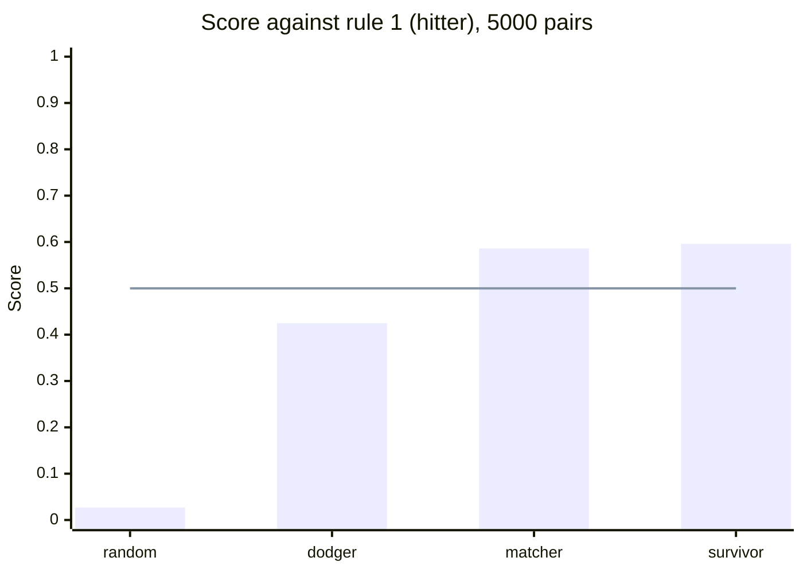
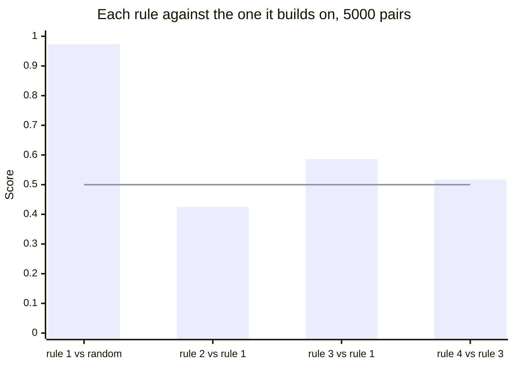

# Results

Every duel and every model of the project, negative results included, in the
order they were made. A score is bot A's share of points over paired battles
(a draw is half a point), with its 95 % Wilson interval: 5000 pairs (10 000
battles) on random teams for rules 1 to 10, 2000 pairs from rule 11 on, each
reproducible with the command above its table. A rule is kept only if the whole
interval is above 0.5. Since the engine is compiled without fused multiply-add
(see the engine README), each line gives the same record, battle for battle, on
macOS and on Linux; the measures played by a network on the Mac are the same
for the same number of processes.

| Part | Question | Answer |
|---|---|---|
| [Rules 1 to 5](#rules-1-to-4) | How far does a heuristic go? | Replacements matter more than moves; the engine's damage beats an estimate |
| [Rules 6 and 7](#rule-5-and-rule-6-against-every-other-bot) | A turn ahead, with a learned win model? | +34 points; assuming the worst is a trap |
| [Rules 8 and 9](#rule-8-a-mixed-strategy-measured-negative) | Does search help without a better judge? | No: the judge is the limit |
| [Palier 6](#palier-6-a-network-by-imitation-then-by-self-play) | A network, then a search it guides? | +17, then +26: once positions are judged well, search pays |
| [Palier 7](#palier-7-how-good-is-rule-12-and-where-it-goes-wrong) | How good is the bot, and where does it go wrong? | Teams decide much; duels stay the measure |
| [Paliers 8 to 10.5](#palier-8-a-faster-loop-and-rule-13) | What does the loop still learn? | Rules 13 to 17, the gains shrinking |
| [Palier 12](#palier-12-teams-built-by-the-ai) | Can the AI build better teams? | +21 points from the species' strengths, then a ceiling |
| [Palier 13](#palier-13-the-battle-with-the-teams-as-they-are) | Can the battle itself improve? | Only by searching more at play time |
| [Palier 14](#palier-14-four-levels) | Four levels for a player? | A regular ladder, about 87 % per step |
| [Where it ended](#where-it-ended) | | The final bot, and what was left undone |

## Rules 1 to 4

Every bot against every other, seeds 0–4999. Each cell is the score of the row's bot against the
column's bot; the whole interval is above 0.5 when the row's bot is better.

| Bot ↓ against → | random | hitter (rule 1) | dodger (rule 2) | matcher (rule 3) | survivor (rule 4) |
|---|---|---|---|---|---|
| **random** | 0.500 | *0.027* | *0.076* | *0.026* | *0.025* |
| **hitter** (rule 1) | 0.973 | 0.500 | *0.575* | *0.414* | *0.404* |
| **dodger** (rule 2) | 0.924 | 0.425 | 0.500 | *0.368* | *0.361* |
| **matcher** (rule 3) | 0.974 | 0.586 | 0.632 | 0.500 | *0.483* |
| **survivor** (rule 4) | **0.975** | **0.596** | **0.639** | **0.517** | 0.500 |

Cells in italics are not measured separately: each is one minus the measured
duel the other way round.





The measured duels, with their intervals:

| Duel | Score | 95 % interval | Record (W / D / L) |
|---|---|---|---|
| random vs random | 0.500 | [0.490, 0.510] | 4969 / 58 / 4973 |
| hitter vs random | 0.973 | [0.970, 0.976] | 9732 / 5 / 263 |
| dodger vs random | 0.924 | [0.919, 0.929] | 9232 / 23 / 745 |
| matcher vs random | 0.974 | [0.970, 0.977] | 9733 / 6 / 261 |
| survivor vs random | 0.975 | [0.971, 0.977] | 9742 / 7 / 251 |
| dodger vs hitter | 0.425 | [0.415, 0.435] | 4228 / 44 / 5728 |
| matcher vs hitter | 0.586 | [0.576, 0.596] | 5837 / 49 / 4114 |
| survivor vs hitter | 0.596 | [0.587, 0.606] | 5938 / 52 / 4010 |
| matcher vs dodger | 0.632 | [0.623, 0.642] | 6302 / 42 / 3656 |
| survivor vs dodger | 0.639 | [0.629, 0.648] | 6364 / 44 / 3592 |
| survivor vs matcher | 0.517 | [0.507, 0.527] | 5148 / 43 / 4809 |

Any line reproduces with `trainerlab duel <bot> <opponent> --pairs 5000`.

**What the table says.**

- **Rule 4 is the best of these four rules**: it beats every other one, rule 3 included
  (0.517, the whole interval above 0.5).
- **Against the random bot, every rule looks alike** (about 0.97): the
  replacement rules of 3 and 4 only pay off against an opponent that plays
  well. Beating the random bot says little once a bot is reasonable.
- **Rule 2 is worse than rule 1 against everyone**, the random bot included.
- **The mirror duels give exactly 0.500, by construction**: a deterministic
  bot against itself plays the same battle twice in a pair, sides swapped, so
  every pair is one win and one loss, or two draws. They check that the
  harness is symmetric, not that the bots are balanced. Random against random,
  whose two bots differ, is the real sanity check: 0.500.

**How the rules were chosen.** Each decision was made earlier on 500 pairs
(seeds 0–499), then confirmed on unseen seeds (10000–10499), before these
5000-pair runs. Seeds 0–4999 include those first 500, so a tenth of these
battles were already seen when the rules were chosen.

### Negative results

**Rule 2 loses to rule 1** (0.425 [0.415, 0.435]). Switching out of a super
effective threat costs a turn, and the incoming Pokémon takes the hit. It is
kept in the code as a measured negative result.

**Rule 4 as first defined did not beat rule 3** (0.494 [0.464, 0.525], from
the version described in the commit that introduced rule 4). It
saved weakened Pokémon (median 36 % HP) at the cost of a hit on the
switch-in, whereas letting a doomed Pokémon faint gives a free switch-in.
Rule 4 above is the corrected version, fixed before being measured.

### Traps found on the way

**One matchup is not every matchup.** The first measurements used two fixed
teams. There, rule 2 beat rule 1 (0.874), and the best replacement formula
was "take the least damage". On random teams, rule 2 loses, and that formula
is the weakest of the three tried.

**Picking the best of several variants on the same data flatters it.** The
replacement formula of rule 3 was chosen before measuring; three
alternatives tried afterwards were checked on unseen seeds before any
conclusion.

**A tournament found a bug in the game loop.** A replacement can faint on
entry (Stealth Rock), so who must replace next can change, or the battle can
end. The loop now asks for one replacement at a time; two regression tests
replay the battles that exposed it.

## Rule 5: the damage the engine expects

The engine now answers one question for any move:
`_engine.expected_damage(view, side, slot)` gives the minimum, maximum and
mean HP the move would take from the opposing active, by playing it through
its own rules over every outcome of the dice (see the engine's [`docs/api.md`](../engine/docs/api.md)). Rule 5 is rule 4
with one change: among its moves, it plays the highest mean. A move into Levitate, Seismic Toss, a second Fake Out, Poltergeist on a
foe with no item or three hits of Triple Axel are now worth what they are
really worth.

The rule was fixed before measuring, and measured once, on seeds that served
to choose nothing (30000–34999):

```bash
trainerlab duel calculator survivor --pairs 5000 --from 30000
```

| Duel | Score | 95 % interval | Record (W / D / L) |
|---|---|---|---|
| calculator (rule 5) vs survivor (rule 4) | **0.631** | [0.621, 0.640] | 6289 / 37 / 3674 |

**Rule 5 beats rule 4 by thirteen points**, more than any step since rule 1
against the random bot (rule 3 gained 8.6 points on rule 1, rule 4 1.7 on
rule 3). The error analysis pointed there: half the losses a decision
caused came from a wrong damage estimate
([`error-analysis.md`](error-analysis.md)).

## Rule 5 and rule 6 against every other bot

```bash
trainerlab duel calculator <bot> --pairs 5000 --from 55000
trainerlab duel forecaster <bot> --pairs 5000 --from 55000   # --from 50000 against calculator
```

| Bot ↓ against → | calculator | survivor | matcher | hitter | dodger | random |
|---|---|---|---|---|---|---|
| **forecaster** (rule 6) | **0.844** [0.837, 0.851] | **0.859** [0.852, 0.866] | **0.864** [0.858, 0.871] | **0.887** [0.880, 0.893] | **0.894** [0.888, 0.900] | 0.985 [0.982, 0.987] |
| **calculator** (rule 5) | | 0.631 [0.621, 0.640] | 0.652 [0.642, 0.661] | 0.730 [0.721, 0.739] | 0.774 [0.765, 0.782] | **0.990** [0.988, 0.992] |

`calculator` against `survivor` is on seeds 30000–34999, the others on
55000–59999.

| Duel | Record (W / D / L) |
|---|---|
| forecaster vs calculator | 8430 / 17 / 1553 |
| forecaster vs survivor | 8580 / 27 / 1393 |
| forecaster vs matcher | 8630 / 28 / 1342 |
| forecaster vs hitter | 8857 / 17 / 1126 |
| forecaster vs dodger | 8924 / 28 / 1048 |
| forecaster vs random | 9845 / 7 / 148 |
| calculator vs survivor | 6289 / 37 / 3674 |
| calculator vs matcher | 6498 / 38 / 3464 |
| calculator vs hitter | 7280 / 45 / 2675 |
| calculator vs dodger | 7719 / 36 / 2245 |
| calculator vs random | 9898 / 6 / 96 |

- **Each bot beats every earlier one, the more clearly as the gap in rules
  grows.** `forecaster` beats every bot measured against it.
- **`forecaster` does not win by knowing the foe's move.** It assumes the
  foe plays as `calculator`, which is exactly true against `calculator`
  (0.844), and only partly against `survivor` and `matcher`, where it scores
  more (0.859, 0.864): those foes are weaker.
- **Against the random bot, `calculator` does slightly better** (0.990
  against 0.985): a foe that plays at random misleads a bot that assumes it
  plays well.

## Rule 7: minimax against exploitation

```bash
trainerlab duel strategist forecaster --pairs 5000 --from 70000
trainerlab duel strategist calculator --pairs 5000 --from 50000
trainerlab duel strategist survivor --pairs 5000 --from 55000
```

| Duel | Score | 95 % interval | Record (W / D / L) | forecaster, same seeds |
|---|---|---|---|---|
| strategist vs forecaster | **0.548** | [0.538, 0.558] | 5462 / 35 / 4503 | |
| strategist vs calculator | 0.739 | [0.730, 0.748] | 7373 / 36 / 2591 | 0.844 |
| strategist vs survivor | 0.812 | [0.804, 0.820] | 8110 / 23 / 1867 | 0.859 |

**There is no single best bot.** Head to head, `strategist` beats
`forecaster`: `forecaster` expects `calculator`'s move, which `strategist`
does not play, while `strategist` always expects the worst reply and is
never caught out. Against every other bot, `forecaster` does clearly better:
it exploits a foe it can predict, whereas `strategist` guards against
replies those foes never play and lets chances go. Exploiting a known foe or
guarding against an unknown one: neither dominates.

## Rule 8: a mixed strategy, measured negative

```bash
trainerlab duel nash strategist --pairs 5000 --from 80000
trainerlab duel nash forecaster --pairs 5000 --from 85000
trainerlab duel nash calculator --pairs 5000 --from 90000
```

| Duel | Score | 95 % interval | Record (W / D / L) | strategist, other seeds |
|---|---|---|---|---|
| nash vs strategist | **0.487** | [0.478, 0.497] | 4858 / 31 / 5111 | |
| nash vs forecaster | 0.533 | [0.524, 0.543] | 5311 / 46 / 4643 | 0.548 |
| nash vs calculator | 0.717 | [0.709, 0.726] | 7150 / 49 / 2801 | 0.739 |

**Mixing does not pay against these bots.** `nash` loses to `strategist`, and
does no better against the others. Being unpredictable only matters against a
foe that exploits a predictable one, and none of these bots does:
`strategist` assumes the worst reply, `forecaster` assumes `calculator`. What
is left is the cost: the odds of each cell are a noisy estimate (one model,
two turns), and between options that look alike the mix sometimes plays the
worse one, where `strategist` plays the safest. Kept in the code as a measured
negative result, for the self-play of palier 6, where the foe learns to
exploit.

## Rule 9: a tree search, measured negative

```bash
trainerlab duel mcts forecaster --pairs 5000 --from 100000
trainerlab duel mcts strategist --pairs 5000 --from 105000
trainerlab usage mcts forecaster --pairs 200 --from 96000
```

| Duel | Score | 95 % interval | Record (W / D / L) |
|---|---|---|---|
| mcts vs forecaster | 0.489 | [0.479, 0.498] | 4873 / 25 / 5102 |
| mcts vs strategist | 0.470 | [0.460, 0.480] | 4681 / 41 / 5278 |

`mcts` lays a hazard 7.8 % of the times it can, against 6 to 8 % for the
other bots that look ahead: the criterion set before measuring fails. **A
deeper search does not reveal what hazards are worth: the limit is the
evaluation**, a model that sees little but Pokémon alive and HP, trained on
games without strategy. With 200 simulations and up to 81 pairs of options,
the search barely explores past the first turn, with one roll of the dice per
simulation where `forecaster` plays two: it plays a little worse, twenty
times slower. Kept in the code: the search over simultaneous moves and the
guessed teams serve again in palier 6, guided by a network.

It is the fifth experiment against the same wall: more data, a network, a
mixed strategy, a tree search, all without gain.

## What the bots do with their turns

```bash
trainerlab usage <bot> forecaster --pairs 200 --from 96000
```

How often each kind of move is played when it is among the bot's options
(attacks, hazards, boosts, statuses, recovery, switches):

| Kind | random | calculator | forecaster | strategist | nash |
|---|---|---|---|---|---|
| attack | 41 % | 93 % | 54 % | 60 % | 57 % |
| **hazard** | **17 %** | 4 % | **6 %** | **8 %** | **8 %** |
| boost | 17 % | 6 % | 23 % | 25 % | 19 % |
| status | 16 % | 18 % | 23 % | 29 % | 27 % |
| recovery | 19 % | 13 % | 27 % | 24 % | 22 % |
| switch | 44 % | 1 % | 26 % | 17 % | 22 % |

- **Hazards are the blind spot.** The bots that look ahead lay them two to
  three times less often than the random bot. The shipped model weighs
  Stealth Rock at nothing (rank 207 of 249): a hazard pays only when the foe
  brings a Pokémon in, turns later, and its training games never showed it.
- **Boosts, statuses and recovery are played a little more than at random**
  by the bots that look ahead: the model gives them a small weight, enough for
  one turn. Whether they come at the right moment, this does not say.
- `calculator`'s statuses and recovery are an artefact: when every move is
  expected to deal nothing, it plays the first in its list.

Set before measuring rule 9: if a deeper search lays hazards clearly more
often than `forecaster`'s 6 %, depth reveals what they are worth; if not,
the limit is the evaluation.

## The models

```bash
trainerlab train calculator-vs-survivor-40000-41999.npz [--model network|network-stop]
trainerlab train calculator-vs-survivor-40000-41999.npz \
  forecaster-vs-calculator-60000-61999.npz forecaster-vs-survivor-62000-63999.npz \
  [--model network-stop]
```

Test: the battles whose seed is a multiple of 5, never seen in training.

| Data | Model | Log loss (test) | Brier (test) | Accuracy (test) | Log loss (train) |
|---|---|---|---|---|---|
| calculator vs survivor | constant | 0.693 | 0.248 | 0.513 | |
| | logistic regression | **0.532** | **0.178** | **0.723** | 0.507 |
| | network, 10 passes | 0.632 | 0.206 | 0.699 | 0.351 |
| | network, stopped early (best after 2 passes) | 0.540 | 0.182 | 0.714 | 0.460 |
| the three datasets | constant | 0.692 | 0.249 | 0.520 | |
| | logistic regression (`gen2`) | **0.394** | **0.126** | **0.816** | 0.409 |
| | network, stopped early (best after 2 passes, `gen2-net`) | 0.400 | 0.129 | 0.810 | 0.362 |

Stopping early cures the network's overfitting, but it stops after two
passes and still does no better than the logistic regression: with these
features, a hidden layer brings nothing.

On the first dataset (147 356 rows from 3200 battles to train, 38 046 rows
from 800 battles to test; the model shipped with rules 6 and 7 is its
logistic regression):

- **The logistic regression predicts the winner of an unseen position
  72 % of the time**, against 51 % for the constant, and its scores in
  training and in test are close: it generalises.
- **The network overfits.** It does much better than the logistic
  regression on the battles it was trained on (0.351) and worse on the
  others (0.632). Rows of one battle look alike and share their label, and
  the species features let it recognise a battle rather than a position:
  3200 battles are few for 16 000 weights. It was measured as fixed in
  advance; stopping it early is the variant measured on the next line.
- **The weights of the logistic regression make sense.** The largest, on
  standardised features: Pokémon alive and total HP of each side (the foe's
  with a minus sign), then the best damage each active can expect, then the
  HP of a few species (Dragapult, Azumarill, Mega Gengar).

## The data loop and the network, in play

```bash
trainerlab duel forecaster:gen2.npz forecaster --pairs 5000 --from 65000
trainerlab duel forecaster:gen2-net.npz forecaster:gen2.npz --pairs 5000 --from 75000
```

| Duel | Score | 95 % interval | Record (W / D / L) |
|---|---|---|---|
| gen2 (also trained on forecaster's games) vs the shipped model | 0.505 | [0.495, 0.515] | 5040 / 17 / 4943 |
| gen2-net (network) vs gen2 (logistic, same data) | 0.473 | [0.463, 0.482] | 4716 / 20 / 5264 |

Two negative results:

- **More data, and data from `forecaster`'s own games, does not make it play
  better** (a draw), although `gen2` predicts the winner of those games
  better. The bot only uses the model to rank positions one turn apart, and
  for that both models lean on the same things, Pokémon alive and HP left:
  they nearly always pick the same option.
- **The network plays worse than the logistic regression** trained on the
  same data, the whole interval below 0.5.

Both point to the same limit: the bot's search (one turn, a guessed foe), not
its evaluation.

## Palier 6: a network, by imitation, then by self-play

### Imitation (6.3)

```bash
trainerlab imitate forecaster calculator --pairs 10000 --from 110000
trainerlab imitate forecaster strategist --pairs 5000 --from 135000
trainerlab pretrain imitate-forecaster-vs-*.npz --out net.pt
```

874 200 decisions of `forecaster`, 8 passes, 3 minutes on the Mac's GPU. On the
battles held out (seeds multiple of 5), the network picks `forecaster`'s option
**71.6 %** of the time (about 14 % at random among the options) and calls the
winner 80 % of the time. Its value overfits: its test error rises along the
passes (0.534 to 0.584) while the policy keeps improving.

| Duel | Score | 95 % interval | Record (W / D / L) |
|---|---|---|---|
| net vs calculator | 0.721 | [0.712, 0.729] | 7189 / 33 / 2778 |
| net vs forecaster | 0.387 | [0.378, 0.397] | 3856 / 32 / 6112 |

Without any search, one evaluation per decision, the network beats
`calculator` as clearly as `strategist` or `nash` do. It stays below the bot it
copies: a copy at 72 % errs where looking ahead matters.

### Self-play with PPO: rule 10 (6.4)

```bash
trainerlab selfplay net.pt --updates 3000 --out selfplay.pt
```

3000 updates, 87 million decisions, 2.76 million battles, 2 h 01 on the Mac.
The follow-up measure against `forecaster` (200 pairs of seeds 150000 and up):

| Update | 0 | 25 | 50 | 75 | 500 | 1000 | 1500 | 2000 | 2500 | 3000 |
|---|---|---|---|---|---|---|---|---|---|---|
| Score | 0.387 | 0.524 | 0.600 | 0.649 | 0.625 | 0.620 | 0.625 | 0.660 | 0.689 | 0.656 |

Nearly everything is learned in the first 75 updates (about 2 million
decisions, 3 minutes), then a long plateau that barely rises. The entropy of the
policy falls from 0.76 to about 0.47 and stays there: it sharpened without
freezing.

```bash
trainerlab duel net:selfplay.pt forecaster --pairs 5000 --from 155000
trainerlab duel net:selfplay.pt strategist --pairs 5000 --from 160000
trainerlab duel net:selfplay.pt net:net.pt --pairs 5000 --from 165000
```

| Duel | Score | 95 % interval | Record (W / D / L) |
|---|---|---|---|
| **rule 10 vs forecaster** | **0.672** | [0.663, 0.681] | 6709 / 28 / 3263 |
| **rule 10 vs strategist** | **0.668** | [0.659, 0.677] | 6666 / 29 / 3305 |
| rule 10 vs the imitation network | 0.765 | [0.757, 0.774] | 7648 / 14 / 2338 |

**Rule 10 is the strongest bot by far**, without any search (shipped as the bot
`selfplay`: `trainerlab play --against selfplay`): it beats
`forecaster` and `strategist` by 17 points, where no search of rules 7 to 9 beat
`forecaster` by more than 5. Self-play added 38 points to imitation.

What it does with its turns (`trainerlab usage net:selfplay.pt forecaster
--pairs 200 --from 96000`), against `forecaster` and the random bot:

| Kind | random | forecaster | rule 10 |
|---|---|---|---|
| attack | 41 % | 54 % | 58 % |
| **hazard** | 17 % | 6 % | **17 %** |
| boost | 17 % | 23 % | 14 % |
| status | 16 % | 23 % | 14 % |
| recovery | 19 % | 27 % | 22 % |
| switch | 44 % | 26 % | 25 % |

**It lays hazards nearly three times as often as `forecaster`**: the first bot
that looks ahead to use them as much as chance does. And not at random: over 60
pairs against `calculator`, it lays them earlier (median turn 6, against 13 for
`forecaster`), most often with five foes or more still standing (62 %, against
52 %), and only 2 of its 24 Stealth Rocks were laid where one already was. It
plays fewer boosts and statuses than `forecaster`, whose win model, judging a
single turn ahead, likely overrated them.

This confirms palier 5's diagnosis: the wall was the evaluation. Once the worth
of a position is learned by playing, the level rises and hazards come back.

### Rule 11: the tree search, guided by the network (6.5)

`planner` is rule 9's tree search over simultaneous moves, guided by rule 10's
network: its policy gives each option a prior, its value rates each new
position, both evaluated in C++ (PUCT, as in AlphaZero; 200 simulations,
8 guessed teams, settings fixed before measuring). About 70 ms a decision,
against 1 ms for the network alone; the duels were cut to 2000 pairs, decided
before any result was seen.

```bash
trainerlab duel planner selfplay --pairs 2000 --from 170000
trainerlab duel planner forecaster --pairs 2000 --from 175000
```

| Duel | Score | 95 % interval | Record (W / D / L) |
|---|---|---|---|
| **rule 11 vs rule 10** | **0.763** | [0.750, 0.776] | 3049 / 8 / 943 |
| **rule 11 vs forecaster** | **0.787** | [0.774, 0.800] | 3143 / 13 / 844 |

**The search adds 26 points to the network**, as much as self-play added to
imitation, and `planner` is the strongest bot. The same kind of search lost to
`forecaster` (rule 9, 0.489) when the win model rated its positions: the search
was never useless, its evaluation held it back.

Its use of moves is nearly rule 10's (hazards 17 %, boosts 13 %, switches 25 %
of the times they are options): the search starts from the network's policy
and stays close to it. It wins by choosing better when to play each kind of
move, not by playing other kinds.

### Rule 12: the network trained on its own search (6.5c)

`rule12` (`alphazero` until palier 8) is rule 11 with a better network, trained by the AlphaZero loop
(`trainerlab alphazero`, `search/src/self_play.cpp`). Each iteration, rule 11
plays 1000 battles against itself on every core: both sides search what they
see, with noise at the root (a quarter of the prior), and play an option drawn
in proportion to its visits. Each decision leaves the share of visits each
option got and the battle's result for that side; the network then learns to
put its policy where the search went and its value on the result, from the
decisions of the last 4 iterations (learning rate 1e-4, 2 passes). Settings
fixed before measuring: 20 iterations from rule 10's network, the last one
measured, never the best of the follow-up duels.

```bash
trainerlab alphazero ai/src/trainerlab/rl/models/selfplay.pt --iterations 20 --out runs/alphazero.pt
trainerlab duel plan:runs/alphazero.pt planner --pairs 2000 --from 180000
```

| Duel | Score | 95 % interval | Record (W / D / L) |
|---|---|---|---|
| **rule 12 vs rule 11** | **0.578** | [0.562, 0.593] | 2305 / 12 / 1683 |

**The loop adds 8 points to the search**, in 2 hours on the Mac (20 000
battles, 1.2 million decisions). The follow-up duels against rule 11 (100
pairs after each iteration, all on the same seeds) rose from 0.555 to about
0.59 within two iterations, then held: the gain comes early, as the network
learns what its search chooses. The value loss fell all along (0.573 to
0.500), the network calling the winner better and better; the policy loss rose
slightly after the fourth iteration (1.39 to 1.48), as the targets moved with
the network that guides the search.

Read battle by battle (`trainerlab watch`, four battles against rule 11), the
bot is strong in tactics: it switches into immunities and resistances, uses
priority to finish, knows which foe has lost its item (it avoids Poltergeist
against one), sets up behind an immunity against a foe locked into its move
by a Choice item, lays Stealth Rock, and plays Destiny Bond and Disguise for
what they are. It is weak in strategy: it boosts in front of a Pokémon that
can phaze it or knock it out the next turn, trades its boosted attacker into a
visible Destiny Bond, leaves a boosted threat alive when a knock-out is there,
and spends the Pokémon that could stop the foe's last one. A revealed foe is
seen whole (each species has one fixed set): these are failures to foresee the
foe's move and to weigh the long run, not missing information.

## Palier 7: how good is rule 12, and where it goes wrong

Palier 7 measures instead of improving: how much teams decide, whether search
is the limit, and which of rule 12's decisions are mistakes. Its lesson is as
much about the measuring tools as about the bot.

### Teams decide much (7.1)

`trainerlab teams` makes a bot play itself, each matchup twice, with dice of
its own and the teams on swapped sides. If teams did not matter, the team that
won the first battle would win the second half the time.

```bash
trainerlab teams rule12 --pairs 3000 --from 190000
```

| Measure (rule 12, 6000 battles) | Value |
|---|---|
| matchups won twice by the same team | **0.654** [0.636, 0.670] (0.5 if teams did not matter) |
| winners called by the composition alone, held-out battles | 0.639 (log loss 0.636, 0.693 for a coin) |
| species whose teams score outside 0.5 at 95 % | 30 of 49 (about 2 by chance) |

In a typical matchup the better team wins about three times in four, with the
same bot on both sides; with `hitter` the agreement is 0.779, as a stronger
bot makes up for part of a weak team. Toxapex (0.700), Mega Rayquaza (0.688)
and Mega Mawile (0.610) lead; Blissey (0.404), Drampa (0.400) and Azelf
(0.372) trail. Some of it matches competitive play (Toxapex, Corviknight),
some is the bot: Blissey and Snorlax want long, patient games, its weak spot.
These scores are a species in the hands of this bot. Duels stay sound: the
same teams play both sides of a pair.

### Search is a limit (7.3)

```bash
trainerlab duel rule12@800 rule12 --pairs 1000 --from 210000
```

Four times the simulations (`@800`) beat rule 12 by **0.569** [0.547, 0.591]:
about 7 points, nearly what the whole AlphaZero loop brought. Speed turns into
strength.

### The judge (7.4)

`trainerlab judge` rates each decision of a bot with a search 16 times deeper:
rule 12's network, 3200 simulations, 16 guessed teams, every legal option
tried at least 50 times so that even the bot's disliked choices get a value.
A decision's loss is what the judge's choice is worth over the bot's, in
points of the chance to win. Settings fixed before measuring; replacements
after a knock-out, chosen without search, are not judged.

```bash
trainerlab judge rule12 planner --pairs 200 --from 220000 --out runs/judge-rule12.npz
trainerlab judge planner rule12 --pairs 200 --from 220000 --out runs/judge-rule11.npz
```

| | rule 11 | rule 12 |
|---|---|---|
| plays the judge's choice | 55.2 % | 73.9 % |
| mean loss, points of the chance to win | 1.79 | 0.67 |
| losing 5 points or more | 10.9 % | 3.1 % |
| losing 10 points or more | 4.6 % | 0.8 % |

The judge searches with rule 12's own network: rule 12 is judged by a deeper
self, which flatters its agreement, while rule 11 has another network. The gap
is real (duels say so), the table overstates it.

### Situations, rated by the judge (7.2, 7.5)

`trainerlab audit` spots situations a program can see: a boost, a boost that
never led to a hit, a boost in front of a foe that can phaze (Whirlwind,
Dragon Tail) or knock the booster out, a fall to Destiny Bond, a sure
knock-out left unplayed. Palier 7.5 adds a priority move that would knock out
a faster foe, staying in against a faster knock-out (above a quarter of the
HP; at or below, a sacrifice), a heal above three quarters of the HP (faster
or slower than the foe), a switch into the foe's best hit being super
effective.

```bash
trainerlab audit rule12 planner --pairs 1000 --from 200000
```

Counted on their own, they made rule 12 look much better than rule 11 (28 %
of its boosts wasted against 41 %). Rated by the judge, **none is a mistake
most of the time**. Each situation's share of decisions losing 5 points or
more, against the bot's share over all its decisions:

| Situation | rule 11 (10.9 %) | rule 12 (3.1 %) |
|---|---|---|
| priority knock-out left unplayed | 26 % | 10 % |
| switch into a weakness | 24 % | 6 % |
| boost in front of a phazer | 20 % | too rare |
| sure knock-out left unplayed | 17 % | 4 % |
| boost in front of a knock-out | 14 % | 4 % |
| boost, boost that came to nothing | 10 % | 3 to 4 % |
| staying in against a faster knock-out | 13 % | 4 % |
| sacrifice | 12 % | 4 % |
| heal at high HP, faster | 8 % | 4 % |
| heal at high HP, slower | 12 % | **1 %** |

Two situations flag mistakes, in both bots: a priority knock-out left
unplayed and a switch into a weakness, two to three times the bot's usual
rate, though the bot is still right most of the time there. A sacrifice and a
heal at high HP are not mistakes; healing while slower, the heal coming after
the foe's hit, is even better than the bot's average. For a bot of this
level, rules do not find its mistakes: they depend on context and are spread
out. The audit describes how a bot plays, not how badly.

### Checking the judge against results (7.6)

`trainerlab verify` replays a battle to one of the judge's worst blunders,
copies the real state, and plays it out 200 times with the bot's option and
200 times with the judge's, by the same bots, the k-th game of each option on
the same dice.

```bash
trainerlab verify rule12 planner --judged runs/judge-rule12.npz --worst 20 --games 200
trainerlab verify planner rule12 --judged runs/judge-rule11.npz --worst 20 --games 200
```

| The 20 worst blunders | rule 11 | rule 12 |
|---|---|---|
| confirmed (the judge's option wins more, at 95 %) | 25 % | 30 % |
| refuted (the bot's wins more) | 5 % | 25 % |
| unclear | 70 % | 45 % |
| loss the judge gave / gap the games measured | 45 / 9 points | 24 / 4.3 points |

**The judge is not reliable decision by decision.** Its worst ratings are
largely noise picked out: among 10 000 decisions, the most extreme ratings are
those where the error ran furthest, and an option tried 50 times has a value
known only to a few points. In 8 of rule 11's 20 positions, every game ended
the same whichever option was played; most are long, locked endgames
(Corviknight against Quagsire after turn 70), where the network, and so the
judge, rates positions it hardly saw in training. Where it is right, it is
clearly so (a position won 200 times out of 200 with its option, lost every
time with the bot's).

So duels remain the measure of strength. The judge's mean loss, averaged over
thousands of decisions, is a secondary indicator, to be read with care; its
share of blunders is inflated. A judge worth trusting would have to be
calibrated on decisions drawn at random rather than on its worst, and an exact
endgame solver would cover where the network is weakest.

## Palier 8: a faster loop, and rule 13

Palier 7 showed that depth pays (four times the simulations, 7 points), so
palier 8 made the loop faster, then spent the time on deeper targets. The
speed-ups, measured on the Mac, are in [`benchmark.md`](benchmark.md): fused
multiply-adds (8.1), the network's layers through Accelerate (8.2), and battles
played side by side in self-play, their network queries batched (8.3). Self-play
on every core went from about 570 to 1 160 decisions per second.

**Reusing the tree from one turn to the next was dropped.** A prototype counted
what it would bring: the subtree of the options actually played holds on
average 51 of the 200 visits (rule 11's network, 2 426 decisions), and none in
24 % of the decisions. Topping it up to 200 would save a quarter of the
simulations, at best 1.3 times faster self-play, and those visits were played
on guessed teams and dice that did not happen: a knock-out in one simulation
and not in another, even another Pokémon in play (3 % of the decisions), where
"move 2" is not the same move. Not worth the risk to the targets.

### The cheaper loop (8.5)

The loop now plays 960 battles per iteration (6 rounds of 16 battles side by
side on 10 threads) and mixes its searches as KataGo does (playout cap
randomization): a quarter of them are full, 800 simulations with noise at the
root, and recorded; the others search 100 simulations without noise and only
move the battle on. Each target comes from a search four times deeper. The
follow-up duel runs every 5 iterations, and the log shows the entropy of the
targets. Settings fixed before measuring.

| Self-play of one iteration (960 battles, Mac) | Decisions recorded | Entropy | Time |
|---|---|---|---|
| 200 simulations everywhere | 56 930 | 1.328 | 49 s |
| a quarter at 800, the others at 100 | 13 945 | 1.215 | 76 s |

Deeper searches cost more per simulation than counted (each goes further down a
larger tree): 55 % more time rather than 37 %, for a quarter of the rows, each
from a search four times deeper.

### Rule 13: rule 12's network, 140 iterations more (8.6)

Settings fixed before measuring: 140 iterations from rule 12's network (as many
as fit before the evening with a margin), the last one measured.

```bash
trainerlab alphazero ai/src/trainerlab/rl/models/rule12.pt --iterations 140 --out runs/rule13.pt
trainerlab duel plan:runs/rule13.pt rule12 --pairs 2000
```

| Duel | Score | 95 % interval | Record (W / D / L) |
|---|---|---|---|
| **rule 13 vs rule 12** | **0.530** | [0.514, 0.545] | 2113 / 13 / 1874 |

**Rule 13 beats rule 12 by 3 points**, in 4 hours 19 minutes (140 iterations,
134 400 battles, 1.9 million decisions recorded; 1.4 minutes per iteration at
first, 1.9 at the end, the Mac warming up). The value loss fell from 0.596 to
about 0.52, the network calling the winner better; the policy loss barely
moved (1.428 to 1.403) and the entropy of the targets held near 1.21. The
follow-up duels (100 pairs, against rule 11 for this run: the command still
named it, it now measures against the network it started from) wandered
between 0.487 and 0.635, as 200 battles do, with no collapse.

The gain is real but smaller than rule 12's 8 points over rule 11, after seven
times the iterations: with this network and this learning rate, the loop has
less left to find. A network that can learn more (palier 10, attention) should
get more out of a loop that is now fast.

## Palier 9: two changes to the search, no gain

Two ideas to foresee the foe better, each measured against rule 13 with the same
network and 200 simulations, 2000 pairs. Neither was kept.

**A tree that keeps a turn's outcomes apart.** A pair of choices led to one
child, whatever the dice: after a knock-out in one simulation and not in
another, "move 2" below mixed the moves of two Pokémon. Splitting the children
by the Pokémon in play once the turn is over changed nothing: **0.500**
[0.484, 0.515]. The mix only happens after a knock-out or a phazing, low in the
tree, where splitting also leaves each child fewer visits.

**A mixed choice from the root's equilibrium.** The two sides choose at once,
and always playing the option visited most is predictable. Drawing the option
from the equilibrium of the zero-sum game the root's pairs of options make
(`solveMatrixGame`) changed a third of the choices, for the worse: **0.385**
[0.370, 0.401]. With 200 simulations spread over dozens of pairs, each pair's
value rests on a few visits: the equilibrium of noise. The visits sum up the
whole search; a pair's value sees a sliver of it. A mixed strategy worth having
would come from the search itself (regret matching at each node), for later.

Guessing the foe's unseen Pokémon by their likelihood was dropped for now: the
teams are drawn at random, so every remaining Pokémon is as likely, which is
what the search assumes already. It will matter once the bots build their
teams.

## Palier 10: attention, the arithmetic, and rule 14

Rule 13's loop gained little (3 points in 140 iterations): the network seemed
to hold it back. Palier 10 gave it attention, then the arithmetic, then fixed
the loop that trains it.

### A network with attention, taught rule 13's search (10.1)

The 12 Pokémon and the field, each placed by a learned embedding, go through 2
layers of attention (normalised first, 4 heads, width 128, a feed-forward of
256) before the trunk: each Pokémon reads the others, and the trunk and the
switches read what they made of each other. The C++ network evaluates it too,
the same as PyTorch to 1e-4 (speed in [`benchmark.md`](benchmark.md)).

It starts from nothing, so it first learns rule 13's search (`trainerlab
distill`): rule 13 plays the loop's battles until it has left 501 864
decisions, with the targets of 800-simulation searches; the student learns them
in passes, the last 5 % of the decisions held out.

```bash
trainerlab distill ai/src/trainerlab/rl/models/rule13.pt --out runs/attention.pt --data runs/distill.npz
```

| Student | Held-out policy loss | Held-out value loss | Against rule 13 (100 pairs) |
|---|---|---|---|
| 8 passes | 1.462 | 0.710 | **0.380** [0.316, 0.449] |
| 3 passes, then 10 iterations of the loop | 1.580 (before the loop) | 0.593 | 0.278, then 0.300 |

Past the third pass, its value learnt the battles by heart: all the decisions
of a battle share its result, and with some 35 000 battles for 500 000
decisions the network came to recognise them. Stopping at 3 passes kept the
value but cost the policy, which the loop then could not recover. Either way it
fell far short of its teacher.

### The arithmetic, and a foe head (10.2)

Each Pokémon's vector read its types, stats and moves, but nothing computed:
the network had to learn the type chart and the damage formula. Its last ten
numbers are now its matchup against the opposing active: each move's
effectiveness and the damage the formula gives at the mean roll (as a share of
the target's HP, without abilities or items), who is faster, and the most the
opposing active would take from it. A network made before reads the columns
before them, and plays as it did. Beside them, self-play records what the foe
played each turn, and a foe head learns to guess it (weight 0.5): our bots'
mistakes came from foreseeing the foe's move (palier 7).

The same 501 864 decisions, generated again with the new columns, taught two
students in 8 passes:

| Student | Held-out policy loss | Held-out value loss (best) | Against rule 13 |
|---|---|---|---|
| no attention (347 373 parameters) | 1.481 | 0.585 | 0.440 [0.373, 0.509] (100 pairs) |
| **attention** (644 973 parameters) | **1.450** | 0.584 (pass 3) | **0.500** [0.485, 0.516] (2000 pairs) |

**The arithmetic made the difference**: the student with attention went from 12
points below its teacher to its exact level, by imitation alone.

### A loop that does not learn by heart

From that student, the loop of palier 8 made it worse: after 53 iterations the
follow-up duels against rule 13 had fallen from about 0.5 to 0.31–0.36, the
value loss on the window had dropped from 0.515 to 0.31 and the policy loss had
risen from 1.465 to 1.49. Each decision came back eight times (2 passes, 4
iterations in the window), and the network with attention, unlike rule 13's,
had the room to learn the results by heart; its search then trusted a value
that judged new positions badly. Stopped.

Three changes: one pass per iteration; the value's loss weighed 0.25 (Leela
Chess Zero's remedy); and each iteration now measures the network on its new
battles before learning them (the "fresh" losses of the log), where learning by
heart shows at once. 33 iterations from the student:

| | Fresh policy loss | Fresh value loss | Against rule 13 |
|---|---|---|---|
| iterations 1–5 | 1.461 | 0.626 | |
| iterations 29–33 | about 1.41 | about 0.58 | **0.512** [0.496, 0.527] |

Stable, and the policy learned, but the gain was within the noise. Raising the
learning rate to 3e-4 (then 1e-4 and 3e-5) made it worse on battles it had not
learned from (fresh policy 1.41 to 1.43–1.46, fresh value 0.57 to 0.60–0.66 by
the 17th iteration): learning harder from noisy targets learns their noise.
Stopped; back to 1e-4.

### The search's value beside the result: rule 14

The result of a battle is a noisy target: the dice decide much of it. The
800-simulation search gives each position its own value, the mean of hundreds of
lines. The value now learns the mean of both; the fresh value stays measured on
the results alone, to compare with the loops before. 33 iterations more:

| Fresh value loss | Iterations 11–15 | 16–20 | 21–25 |
|---|---|---|---|
| the result alone | 0.621 | 0.612 | 0.598 |
| **mixed with the search's value** | **0.570** | **0.573** | **0.567** |

```bash
trainerlab alphazero runs/attention.pt --iterations 33 --out runs/rule14.pt --against rule13
trainerlab alphazero runs/rule14.pt --iterations 33 --out runs/rule14c.pt --against rule13
trainerlab duel plan:runs/rule14c.pt rule13 --pairs 2000 --from 290000
```

| Duel | Score | 95 % interval | Record (W / D / L) |
|---|---|---|---|
| **rule 14 vs rule 13** | **0.539** | [0.523, 0.554] | 2141 / 27 / 1832 |

**Rule 14 beats rule 13 by 4 points**, more than rule 13 gained over rule 12,
in 66 iterations rather than 140. How much of the last 2.7 points the mixed
value brought, rather than 33 more iterations, the intervals do not tell; the
fresh value, lower all along, says it helped. Its rise over the last three
iterations (0.60 to 0.62) is to watch.

Played by a human (one battle, which measures nothing but shows something), rule
13 lost, sending its Kommo-o, four times weak to Fairy, in front of an
Azumarill: its replacements are its network's favourite, never searched.


## Palier 10.5: replacements, team sizes, and rule 17

The commands above name the bots as they were then. Palier 11 renamed them:
`rule12` is now `zero`, `rule13` `deepzero`, `rule14` `focus`; rule 15 is
`scout`, rule 16 `scholar`, and `alphazero` is always the strongest, rule 17.

Rule 14 still sent in its network's favourite after a knock-out, never searched,
and self-play never recorded those choices: the network hardly learnt them. Four
changes followed, each measured by one duel of 2000 pairs against the rule
before it.

### Real endgames replayed: measured negative

Palier 7 found the network weakest in long endgames. Each self-play battle kept
its first endgame (3 Pokémon or fewer standing on each side, a turn to play), and
a quarter of the next iteration's battles started from one of them, with dice of
their own. 70 iterations from rule 14 scored **0.511** against it, the interval
reaching below 0.5: not kept as a rule. The code was removed with rule 17.

### Rule 15: searched replacements

After a knock-out with a choice, the planner plays each option on the view and
searches the position it leaves, a quarter of a decision's simulations each,
and sends in the best value. Rule 14's network, unchanged:

| Duel | Score | 95 % interval |
|---|---|---|
| **rule 15 vs rule 14** | **0.549** | [0.534, 0.565] |

5 points from one decision in a few dozen: the replacement after a knock-out
decides much (rule 13's Kommo-o in front of an Azumarill).

### Rule 16: the replacements learnt

Self-play now searches its replacements too (50 simulations, no noise), and
each becomes a row: the replacing side's view, its options, the chosen one as
the policy target, the best value beside the result. 40 iterations from rule
15, with the endgames replayed in a quarter of the battles:

| Duel | Score | 95 % interval |
|---|---|---|
| **rule 16 vs rule 15** | **0.540** | [0.524, 0.555] |

### Rule 17: teams of 2 to 6, a lower rate at the end

Self-play played only teams of six, and the endgames above did not pay. Half
the battles are now 6 against 6, a quarter 4 against 4, a quarter 2 against 2;
no endgame replayed; the learning rate falls from 1e-4 to 3e-5 for the last
quarter of the iterations. 40 iterations from rule 16, about 5.9 minutes each
on the Mac (235 minutes):

```bash
trainerlab alphazero runs/rule16.pt --iterations 40 --out runs/rule17.pt --against alphazero
trainerlab duel plan:runs/rule17.pt alphazero --pairs 2000 --from 330000
```

The follow-ups against rule 16, every 5 iterations, 100 pairs each (noisy, not the measure): 0.485,
0.517, 0.600, 0.532, 0.535, 0.512, 0.520, 0.517.

| Duel | Score | 95 % interval | Record (W / D / L) |
|---|---|---|---|
| **rule 17 vs rule 16** | **0.517** | [0.502, 0.532] | 2060 / 16 / 1924 |

**Rule 17 beats rule 16**, narrowly: the whole interval is above 0.5, by two
tenths of a point. The gains shrink rule after rule (5.5, 4, then 1.7 points);
what the loop can still teach this network with these settings is little.

Chained, each rule against the one before: rule 14 +3.9 points, rule 15 +4.9,
rule 16 +4.0, rule 17 +1.7.

## Palier 12: teams, built by the AI

Until now every battle was played with two random teams. Palier 12 asks how
much the composition of a team decides a battle, and whether the AI can choose
a better one. Every measure is played by `alphazero` (rule 17) on both sides, so
only the teams differ. Measured on the Mac, 22 to 25 November 2026.

### How much the teams decide (12.1)

`trainerlab teams` plays each matchup of two random teams twice, the sides
swapped, under different dice. If teams did not matter, the same team would win
both battles of a pair half the time:

```bash
trainerlab teams alphazero --size 6 --pairs 55000 --from 450000 --out runs/teams-6b.npz
```

| Teams of | Pairs | Seeds | Same team wins both | Composition alone: winners called (log loss) | Species outside 0.5 |
|---|---|---|---|---|---|
| 6 | 10 000 | 340000 | 0.654 [0.645, 0.664] | 0.678 (0.609) | 35 / 49 |
| 6 (`teams-6b`) | 55 000 | 450000 | 0.658 [0.654, 0.662] | 0.663 (0.616) | 42 / 49 |
| 4 | 10 000 | 400000 | 0.675 [0.666, 0.685] | 0.652 (0.622) | 34 / 49 |
| 2 | 10 000 | 350000 | 0.778 [0.769, 0.786] | 0.662 (0.621) | 37 / 49 |

Rule 17 at 6 agrees with rule 12 in palier 7 (0.654). The smaller the team,
the more each Pokémon weighs. A species' score is the share of points of the
teams that held it. At 6 (`teams-6b`, 110 000 battles) Toxapex leads by far
(0.738 [0.733, 0.743]), then Mega Rayquaza 0.679, Galarian Weezing 0.587,
Mega Mawile 0.585, Corviknight 0.579; Snorlax is last (0.405), with Drampa
0.419, Blissey 0.428, Starmie 0.429. At 2, Mimikyu leads (0.727) and Toxapex
is only average (0.514): a wall needs teammates.

### Builders, and the draft (12.1)

A builder completes a team around a core. A pair draws from its seed a core of
one or two Pokémon for each side (always fewer than the team holds), builder A
completes side 0's core and builder B side 1's, then they swap, under the same
dice. `random` adds species at random; `species` adds the best scored species
of `teams-6b` it may, skipping one after which no legal team could be completed.

With every species to choose from, `species` always builds nearly the same
team. In the **draft**, the seed also draws a pool of 12 species, the same for
both sides, outside the cores, without Megas or legendaries when a core holds
one, and drawn again until every core can be completed. Each builder picks from
the pool alone. The draft is the main measure; free choice the secondary one.

```bash
trainerlab build species:runs/teams-6b.npz random --size 6 --pairs 2000 --from 430000
```

| Teams of | `species` vs `random`, free choice | in the draft |
|---|---|---|
| 2 | 0.715 [0.700, 0.728] | **0.648** [0.633, 0.663] |
| 4 | 0.814 [0.802, 0.826] | **0.696** [0.681, 0.710] |
| 6 | 0.821 [0.809, 0.833] | **0.712** [0.698, 0.726] |

Seeds 360000 / 370000 / 380000 (free) and 410000 / 420000 / 430000 (draft).
Choosing the species well wins 15 to 32 points, more than any rule since rule 11.

### The truth (12.2, 12.4)

`trainerlab truth` measures teams one by one: each against many random ones,
each pair twice. Every team of two (1093), 300 pairs each:

```bash
trainerlab truth alphazero --pairs 300 --from 1000000 --out runs/truth-2.npz
trainerlab truth alphazero --size 6 --teams 150 --pairs 200 --from 3000000 --out runs/truth-6.npz
```

| Teams of | Teams × pairs | Spread of the scores | Error of a score | Share of the spread due to the teams |
|---|---|---|---|---|
| 2 | 1093 × 300 | 0.131 | 0.020 | 98 % |
| 6 | 150 × 200 | 0.138 | 0.024 | 97 % |

At 2 the best team is Azumarill + Mega Rayquaza (0.882), the worst Blissey +
Drampa (0.112). The sum of the species' strengths (an additive model, in
logits) explains 90 % of the spread, the dice about 2.5 %, and synergies the
remaining 7.5 % (Alolan Ninetales + Hisuian Zoroark 0.613 where 0.474 was
expected; Golisopod + Toxapex 0.393 for 0.509). At 6 the species' scores of an
independent measure (`teams-6`) rank the 150 teams with a rank correlation of
0.933 and explain 88.7 % of the spread.

### Faster measures (12.3)

92 % of a measure's time was the C++ search. `search::playMatches` now plays a
measure's battles side by side in C++, 16 per thread, with the referee's dice:

| Measure (Mac) | Before | After |
|---|---|---|
| 200 battles, 6 against 6 | 71.5 s | 54.7 s (×1.31) |
| 2000 battles, 2 against 2 | 116.1 s | 77.4 s (×1.50) |

Refilling each place as soon as its battle ends, in one call, gave **no more
speed** (0.348 s per battle of 6 against 6 over the 110 000 of `teams-6b`, 10 h
37 min, against 0.345 s before): the M4's matrix units, shared by the cores,
are the limit, not idle cores. It was kept for its progress bar and an
immediate Ctrl-C.

### An evaluator of teams (12.4)

`trainerlab evaluator` learns the strength of a team from every battle above
(Bradley-Terry: P(A beats B) = σ(v_A − v_B)), and is judged on battles set
aside: 20 % of each truth file's teams, and the pairs of the `teams` files whose
seed is a multiple of 5. The judge was chosen before: the held-out battles of
`teams-6b`, the log loss compared battle by battle with a 95 % interval.

```bash
trainerlab evaluator runs/truth-2.npz runs/truth-6.npz runs/teams-2.npz runs/teams-4.npz \
    runs/teams-6.npz runs/teams-6b.npz --out runs/evaluator.pt
```

First attempt, **negative**: attention over the species' identities fits the
battles it learnt better than the additive model (loss 0.6213 against 0.6264)
but does no better on the rest (0.626 / 0.622 / 0.621 against 0.626 / 0.623 /
0.620): it remembers, it does not generalise.

Second attempt, declared as such: attention over what each species is (its
types, base stats, ability, item, moves; 201 numbers), with dropout and weight
decay, every setting fixed before. 885 800 battles, 597 568 learnt:

| Model | Judge (`teams-6b` held out): log loss lower than additive by | Rank correlation, teams of 2 / of 6 |
|---|---|---|
| additive | — | 0.945 / 0.922 |
| attention, identities | — | 0.934 / 0.924 |
| **attention, traits** | **+0.0023** [+0.0010, +0.0037] | 0.942 / **0.959** |

The criterion is met, but the gain is small: composition alone lowers the log
loss from 0.693 (a coin) to 0.616; the traits add 0.0023 to that.

### A builder that uses the evaluator (12.5): measured negative

`net:FILE.pt` rates every legal completion of the core from the pool with the
evaluator (a beam of 64 when there are more than 20 000), and keeps the best.
To be kept, it had to beat `species` in the draft, the whole interval above 0.5:

```bash
trainerlab build net:runs/evaluator.pt species:runs/teams-6b.npz --size 6 --pairs 2000 --from 525000
```

| Teams of | Seeds | `net` vs `species` |
|---|---|---|
| 2 | 505000 | 0.499 [0.484, 0.514] |
| 4 | 515000 | 0.507 [0.491, 0.522] |
| 6 | 525000 | 0.507 [0.492, 0.522] |

Not kept. What the evaluator knows beyond the species' strengths does not turn
into wins: composition has reached its ceiling with this roster.

### What changes

The bot of `trainerlab play` now builds its team as `species` does in the
draft: a core from the seed, completed from a pool of 12 with the species'
strengths of `teams-6b`, shipped in `ai/src/trainerlab/game/species-strength.json`:

```bash
trainerlab teams --load runs/teams-6b.npz --strengths ai/src/trainerlab/game/species-strength.json
```

## Palier 13: the battle, with the teams as they are

Composition had reached its ceiling with this roster; palier 13 tried to make
the bot itself stronger, without new species. Four ideas, each settled by one
duel of 2000 pairs, its settings fixed before. Measured on the Mac, 25 to 27
November 2026.

### The lead (13.1)

The foe's team is unknown before the battle. `alphazero+lead` values each of
its Pokémon at the head of its team: against each species the foe could lead
with, the network's value of the start of the battle (both leads seen, the rest
of the foe's team hidden), weighed by the chance that the foe leads with it. That
chance follows the odds w / (1 − w) of the species' lead score w, the share of
points of the random teams it led in `teams-6b`:

```bash
trainerlab teams --load runs/teams-6b.npz --leads ai/src/trainerlab/game/lead-strength.json
trainerlab duel alphazero+lead alphazero --pairs 2000 --from 535000
```

| Duel | Score | 95 % interval | Record (W / D / L) |
|---|---|---|---|
| `alphazero+lead` vs `alphazero` | 0.509 | [0.494, 0.525] | 2027 / 22 / 1951 |

At most a point: the bot switches freely from the first turn, and a poor lead
is soon mended. The criterion is not met, but the lead is kept where a player
sees it: in `trainerlab play`, a search bot chooses its lead, as a player does.
The measures leave it out; `+lead` names it.

### Worlds weighed by strength (13.2): measured negative

The search guesses the foe's unseen Pokémon as 8 legal teams, every species
alike. A foe that builds well holds strong species more often: `+weighted` drew
each in proportion to the odds of its strength (Toxapex about four times as
often as Snorlax). The duel that decided was played on teams built as the bot
of `play` builds its own (`duel --teams species`):

| Duel | Teams | Score | 95 % interval |
|---|---|---|---|
| **`alphazero+weighted` vs `alphazero`** | species | **0.493** | [0.477, 0.508] |
| `alphazero+weighted` vs `alphazero` | random | 0.496 | [0.481, 0.512] |

Not kept, and removed: uniform worlds do not bias the search measurably. It
plays mostly on the Pokémon in front of it, already seen.

### Deeper searches (13.3)

| Duel | Seeds | Score | 95 % interval |
|---|---|---|---|
| `alphazero@400` vs `alphazero` (200) | 537000 | **0.534** | [0.518, 0.549] |
| `alphazero@800` vs `alphazero` | 539000 | **0.571** | [0.556, 0.587] |
| `alphazero@1600` vs `alphazero@800` | 541000 | **0.523** | [0.507, 0.538] |
| `alphazero@3200` vs `alphazero@1600` | 545000 | **0.525** | [0.509, 0.540] |

Four times the simulations win 7 points, as for rule 12 in palier 7; each
doubling after 800 still wins about 2.5. (`alphazero@1600` against `alphazero`,
seeds 543000, was stopped by hand as redundant with the chain: no result.) No ceiling in sight at 3200, where a
decision takes about a quarter of a second on one core.

### Learning from deeper searches (13.4): measured negative

Rule 13 came from a loop whose recorded searches were deeper. From rule 17, the
same loop with recorded searches of 3200 simulations (800 before) and fast ones
of 400 (100), 40 iterations, about 20 minutes each on the Mac:

```bash
trainerlab alphazero ai/src/trainerlab/rl/models/alphazero.pt --iterations 40 \
    --simulations 3200 --fast 400 --against alphazero --out runs/rule18.pt
trainerlab duel plan:runs/rule18.pt alphazero --pairs 2000 --from 551000
```

| Duel | Score | 95 % interval | Record (W / D / L) |
|---|---|---|---|
| rule 18 vs rule 17 | 0.510 | [0.495, 0.526] | 2034 / 16 / 1950 |

Not kept. The policy's loss on battles not yet learned stayed where it was (1.178
at the first iteration, 1.168 at the last): this network does not learn what a
search of 3200 simulations sees. The loop's gains shrank rule after rule (4.9,
4.0, 1.7, now 1.0 and not significant); what deeper search adds is there at play
time, in simulations.

## Palier 14: four levels

`trainerlab play --level easy|medium|hard|impossible` (in French too: facile,
moyen, difficile). Each level is a bot and the kind of team it plays; the
player's team is random, or chosen with `--team`. Each bot keeps its own kind of
team on both sides of a pair (`duel --teams A,B`), so a duel measures the whole
level.

| Level | Bot | Its team |
|---|---|---|
| Easy | `matcher` (rule 3) | random |
| Medium | `forecaster` (rule 6) | random |
| Hard | `alphazero` (rule 17, 200 simulations) | random |
| Impossible | `alphazero@3200` | `species` |

Easy and medium were chosen, before measuring, as the pair that makes the two
first steps the most even (closest in logit) among a random or a `species` team
for each:

```bash
trainerlab duel forecaster matcher --teams species,random --pairs 2000 --from 557000
trainerlab duel alphazero forecaster --teams random,species --pairs 2000 --from 565000
```

| Duel (2000 pairs) | Teams | Seeds | Score | 95 % interval |
|---|---|---|---|---|
| **forecaster vs matcher** | **random, random** | 555000 | **0.874** | [0.863, 0.884] |
| forecaster vs matcher | species, random | 557000 | 0.931 | [0.923, 0.939] |
| forecaster vs matcher | random, species | 559000 | 0.811 | [0.799, 0.823] |
| forecaster vs matcher | species, species | 561000 | 0.897 | [0.887, 0.906] |
| **alphazero vs forecaster** | **random, random** | 563000 | **0.881** | [0.870, 0.890] |
| alphazero vs forecaster | random, species | 565000 | 0.771 | [0.758, 0.784] |

Each level wins about 87 % of its battles against the one below. Impossible
against hard was not measured to its end; from its two parts, measured apart, it
is about 0.80: 3200 simulations rather than 200 add 0.48 in logit (palier 13),
a `species` team rather than a random one 0.91 (palier 12, teams of 6), if the
two add up.

In the menu, Play asks the level first; any bot by its name stays under Another
bot. The battle names the level (Turn 3 · Hard), and medium is the default, the
bot `play` faced before.

## Where it ended

The strongest bot is `alphazero`, rule 17: a tree search over simultaneous
moves guided by a network with attention, taught rule 13's search, then 146
iterations of the loop on its own search (rules 14, 16 and 17). It builds its team from the species' measured strengths
and chooses its lead. Searching 3200 simulations rather than 200, it wins about
12 points more; that is the impossible level.

What the measures say is left to gain, and was not done:

- **More species.** Composition reached its ceiling with 49 species (palier
  12); a larger roster, with a network that reads a species' properties, would
  give more room for roles, synergies and counters.
- **A larger network.** The loop stopped learning from deeper searches (13.4),
  while deeper searches still win at play time: a network with more capacity,
  taught by a search of 3200 simulations, might absorb them. It would have to
  win at equal time, not equal simulations.
- **A league of opponents.** Every network learnt against itself; past
  versions and bots that look for its weaknesses would test it harder.
- **Showdown.** Playing real players, on Pokémon Showdown's rules.
