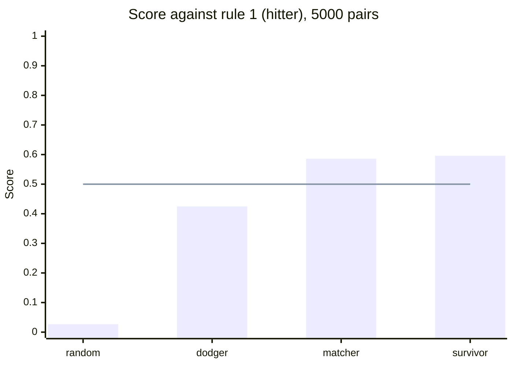
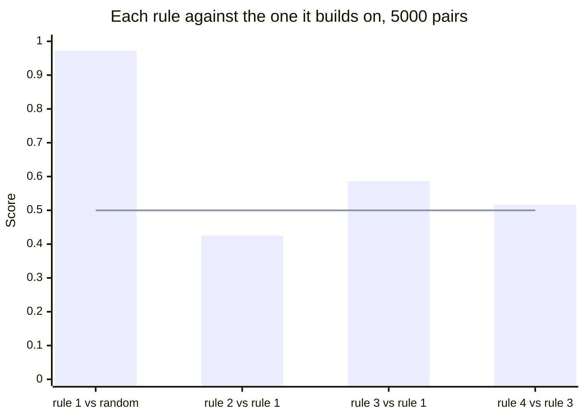

# Results

Every line is a score over **5000 pairs of battles (10 000 battles)** on
random teams, with its 95 % Wilson interval, reproducible with the command
above its table. Since the engine is compiled without fused multiply-add
(see the engine README), each line gives the same record, battle for
battle, on macOS and on Linux.

## Rules 1 to 4

Every bot against every other, seeds 0–4999. Each cell is the score of the row's bot against the
column's bot; the whole interval is above 0.5 when the row's bot is better.

| Bot ↓ against → | random | hitter (rule 1) | dodger (rule 2) | matcher (rule 3) | survivor (rule 4) |
|---|---|---|---|---|---|
| **random** | 0.500 | *0.027* | *0.076* | *0.026* | *0.025* |
| **hitter** (rule 1) | 0.973 | 0.500 | *0.575* | *0.414* | *0.404* |
| **dodger** (rule 2) | 0.924 | 0.425 | 0.500 | *0.368* | *0.361* |
| **matcher** (rule 3) | 0.974 | 0.586 | 0.632 | 0.500 | *0.483* |
| **survivor** (rule 4) | **0.975** | **0.596** | **0.639** | **0.517** | 0.500 |

Cells in italics are not measured separately: each is one minus the measured
duel the other way round.





The measured duels, with their intervals:

| Duel | Score | 95 % interval | Record (W / D / L) |
|---|---|---|---|
| random vs random | 0.500 | [0.490, 0.510] | 4969 / 58 / 4973 |
| hitter vs random | 0.973 | [0.970, 0.976] | 9732 / 5 / 263 |
| dodger vs random | 0.924 | [0.919, 0.929] | 9232 / 23 / 745 |
| matcher vs random | 0.974 | [0.970, 0.977] | 9733 / 6 / 261 |
| survivor vs random | 0.975 | [0.971, 0.977] | 9742 / 7 / 251 |
| dodger vs hitter | 0.425 | [0.415, 0.435] | 4228 / 44 / 5728 |
| matcher vs hitter | 0.586 | [0.576, 0.596] | 5837 / 49 / 4114 |
| survivor vs hitter | 0.596 | [0.587, 0.606] | 5938 / 52 / 4010 |
| matcher vs dodger | 0.632 | [0.623, 0.642] | 6302 / 42 / 3656 |
| survivor vs dodger | 0.639 | [0.629, 0.648] | 6364 / 44 / 3592 |
| survivor vs matcher | 0.517 | [0.507, 0.527] | 5148 / 43 / 4809 |

Any line reproduces with `trainerlab duel <bot> <opponent> --pairs 5000`.

**What the table says.**

- **Rule 4 is the best of these four rules**: it beats every other one, rule 3 included
  (0.517, the whole interval above 0.5).
- **Against the random bot, every rule looks alike** (about 0.97): the
  replacement rules of 3 and 4 only pay off against an opponent that plays
  well. Beating the random bot says little once a bot is reasonable.
- **Rule 2 is worse than rule 1 against everyone**, the random bot included.
- **The mirror duels give exactly 0.500, by construction**: a deterministic
  bot against itself plays the same battle twice in a pair, sides swapped, so
  every pair is one win and one loss, or two draws. They check that the
  harness is symmetric, not that the bots are balanced. Random against random,
  whose two bots differ, is the real sanity check: 0.500.

**How the rules were chosen.** Each decision was made earlier on 500 pairs
(seeds 0–499), then confirmed on unseen seeds (10000–10499), before these
5000-pair runs. Seeds 0–4999 include those first 500, so a tenth of these
battles were already seen when the rules were chosen.

### Negative results

**Rule 2 loses to rule 1** (0.425 [0.415, 0.435]). Switching out of a super
effective threat costs a turn, and the incoming Pokémon takes the hit. It is
kept in the code as a measured negative result.

**Rule 4 as first defined did not beat rule 3** (0.494 [0.464, 0.525], from
the version described in the commit that introduced rule 4). It
saved weakened Pokémon (median 36 % HP) at the cost of a hit on the
switch-in, whereas letting a doomed Pokémon faint gives a free switch-in.
Rule 4 above is the corrected version, fixed before being measured.

### Traps found on the way

**One matchup is not every matchup.** The first measurements used two fixed
teams. There, rule 2 beat rule 1 (0.874), and the best replacement formula
was "take the least damage". On random teams, rule 2 loses, and that formula
is the weakest of the three tried.

**Picking the best of several variants on the same data flatters it.** The
replacement formula of rule 3 was chosen before measuring; three
alternatives tried afterwards were checked on unseen seeds before any
conclusion.

**A tournament found a bug in the game loop.** A replacement can faint on
entry (Stealth Rock), so who must replace next can change, or the battle can
end. The loop now asks for one replacement at a time; two regression tests
replay the battles that exposed it.

## Rule 5: the damage the engine expects

The engine now answers one question for any move:
`_engine.expected_damage(view, side, slot)` gives the minimum, maximum and
mean HP the move would take from the opposing active, by playing it through
its own rules over every outcome of the dice (see the engine's [`docs/api.md`](../engine/docs/api.md)). Rule 5 is rule 4
with one change: among its moves, it plays the highest mean. A move into Levitate, Seismic Toss, a second Fake Out, Poltergeist on a
foe with no item or three hits of Triple Axel are now worth what they are
really worth.

The rule was fixed before measuring, and measured once, on seeds that served
to choose nothing (30000–34999):

```bash
trainerlab duel calculator survivor --pairs 5000 --from 30000
```

| Duel | Score | 95 % interval | Record (W / D / L) |
|---|---|---|---|
| calculator (rule 5) vs survivor (rule 4) | **0.631** | [0.621, 0.640] | 6289 / 37 / 3674 |

**Rule 5 beats rule 4 by thirteen points**, more than any step since rule 1
against the random bot (rule 3 gained 8.6 points on rule 1, rule 4 1.7 on
rule 3). The error analysis pointed there: half the losses a decision
caused came from a wrong damage estimate
([`error-analysis.md`](error-analysis.md)).

## Rule 5 and rule 6 against every other bot

```bash
trainerlab duel calculator <bot> --pairs 5000 --from 55000
trainerlab duel forecaster <bot> --pairs 5000 --from 55000   # --from 50000 against calculator
```

| Bot ↓ against → | calculator | survivor | matcher | hitter | dodger | random |
|---|---|---|---|---|---|---|
| **forecaster** (rule 6) | **0.844** [0.837, 0.851] | **0.859** [0.852, 0.866] | **0.864** [0.858, 0.871] | **0.887** [0.880, 0.893] | **0.894** [0.888, 0.900] | 0.985 [0.982, 0.987] |
| **calculator** (rule 5) | | 0.631 [0.621, 0.640] | 0.652 [0.642, 0.661] | 0.730 [0.721, 0.739] | 0.774 [0.765, 0.782] | **0.990** [0.988, 0.992] |

`calculator` against `survivor` is on seeds 30000–34999, the others on
55000–59999.

| Duel | Record (W / D / L) |
|---|---|
| forecaster vs calculator | 8430 / 17 / 1553 |
| forecaster vs survivor | 8580 / 27 / 1393 |
| forecaster vs matcher | 8630 / 28 / 1342 |
| forecaster vs hitter | 8857 / 17 / 1126 |
| forecaster vs dodger | 8924 / 28 / 1048 |
| forecaster vs random | 9845 / 7 / 148 |
| calculator vs survivor | 6289 / 37 / 3674 |
| calculator vs matcher | 6498 / 38 / 3464 |
| calculator vs hitter | 7280 / 45 / 2675 |
| calculator vs dodger | 7719 / 36 / 2245 |
| calculator vs random | 9898 / 6 / 96 |

- **Each bot beats every earlier one, the more clearly as the gap in rules
  grows.** `forecaster` beats every bot measured against it.
- **`forecaster` does not win by knowing the foe's move.** It assumes the
  foe plays as `calculator`, which is exactly true against `calculator`
  (0.844), and only partly against `survivor` and `matcher`, where it scores
  more (0.859, 0.864): those foes are weaker.
- **Against the random bot, `calculator` does slightly better** (0.990
  against 0.985): a foe that plays at random misleads a bot that assumes it
  plays well.

## Rule 7: minimax against exploitation

```bash
trainerlab duel strategist forecaster --pairs 5000 --from 70000
trainerlab duel strategist calculator --pairs 5000 --from 50000
trainerlab duel strategist survivor --pairs 5000 --from 55000
```

| Duel | Score | 95 % interval | Record (W / D / L) | forecaster, same seeds |
|---|---|---|---|---|
| strategist vs forecaster | **0.548** | [0.538, 0.558] | 5462 / 35 / 4503 | |
| strategist vs calculator | 0.739 | [0.730, 0.748] | 7373 / 36 / 2591 | 0.844 |
| strategist vs survivor | 0.812 | [0.804, 0.820] | 8110 / 23 / 1867 | 0.859 |

**There is no single best bot.** Head to head, `strategist` beats
`forecaster`: `forecaster` expects `calculator`'s move, which `strategist`
does not play, while `strategist` always expects the worst reply and is
never caught out. Against every other bot, `forecaster` does clearly better:
it exploits a foe it can predict, whereas `strategist` guards against
replies those foes never play and lets chances go. Exploiting a known foe or
guarding against an unknown one: neither dominates.

## Rule 8: a mixed strategy, measured negative

```bash
trainerlab duel nash strategist --pairs 5000 --from 80000
trainerlab duel nash forecaster --pairs 5000 --from 85000
trainerlab duel nash calculator --pairs 5000 --from 90000
```

| Duel | Score | 95 % interval | Record (W / D / L) | strategist, other seeds |
|---|---|---|---|---|
| nash vs strategist | **0.487** | [0.478, 0.497] | 4858 / 31 / 5111 | |
| nash vs forecaster | 0.533 | [0.524, 0.543] | 5311 / 46 / 4643 | 0.548 |
| nash vs calculator | 0.717 | [0.709, 0.726] | 7150 / 49 / 2801 | 0.739 |

**Mixing does not pay against these bots.** `nash` loses to `strategist`, and
does no better against the others. Being unpredictable only matters against a
foe that exploits a predictable one, and none of these bots does:
`strategist` assumes the worst reply, `forecaster` assumes `calculator`. What
is left is the cost: the odds of each cell are a noisy estimate (one model,
two turns), and between options that look alike the mix sometimes plays the
worse one, where `strategist` plays the safest. Kept in the code as a measured
negative result, for the self-play of palier 6, where the foe learns to
exploit.

## Rule 9: a tree search, measured negative

```bash
trainerlab duel mcts forecaster --pairs 5000 --from 100000
trainerlab duel mcts strategist --pairs 5000 --from 105000
trainerlab usage mcts forecaster --pairs 200 --from 96000
```

| Duel | Score | 95 % interval | Record (W / D / L) |
|---|---|---|---|
| mcts vs forecaster | 0.489 | [0.479, 0.498] | 4873 / 25 / 5102 |
| mcts vs strategist | 0.470 | [0.460, 0.480] | 4681 / 41 / 5278 |

`mcts` lays a hazard 7.8 % of the times it can, against 6 to 8 % for the
other bots that look ahead: the criterion set before measuring fails. **A
deeper search does not reveal what hazards are worth: the limit is the
evaluation**, a model that sees little but Pokémon alive and HP, trained on
games without strategy. With 200 simulations and up to 81 pairs of options,
the search barely explores past the first turn, with one roll of the dice per
simulation where `forecaster` plays two: it plays a little worse, twenty
times slower. Kept in the code: the search over simultaneous moves and the
guessed teams serve again in palier 6, guided by a network.

It is the fifth experiment against the same wall: more data, a network, a
mixed strategy, a tree search, all without gain.

## What the bots do with their turns

```bash
trainerlab usage <bot> forecaster --pairs 200 --from 96000
```

How often each kind of move is played when it is among the bot's options
(attacks, hazards, boosts, statuses, recovery, switches):

| Kind | random | calculator | forecaster | strategist | nash |
|---|---|---|---|---|---|
| attack | 41 % | 93 % | 54 % | 60 % | 57 % |
| **hazard** | **17 %** | 4 % | **6 %** | **8 %** | **8 %** |
| boost | 17 % | 6 % | 23 % | 25 % | 19 % |
| status | 16 % | 18 % | 23 % | 29 % | 27 % |
| recovery | 19 % | 13 % | 27 % | 24 % | 22 % |
| switch | 44 % | 1 % | 26 % | 17 % | 22 % |

- **Hazards are the blind spot.** The bots that look ahead lay them two to
  three times less often than the random bot. The shipped model weighs
  Stealth Rock at nothing (rank 207 of 249): a hazard pays only when the foe
  brings a Pokémon in, turns later, and its training games never showed it.
- **Boosts, statuses and recovery are played a little more than at random**
  by the bots that look ahead: the model gives them a small weight, enough for
  one turn. Whether they come at the right moment, this does not say.
- `calculator`'s statuses and recovery are an artefact: when every move is
  expected to deal nothing, it plays the first in its list.

Set before measuring rule 9: if a deeper search lays hazards clearly more
often than `forecaster`'s 6 %, depth reveals what they are worth; if not,
the limit is the evaluation.

## The models

```bash
trainerlab train calculator-vs-survivor-40000-41999.npz [--model network|network-stop]
trainerlab train calculator-vs-survivor-40000-41999.npz \
  forecaster-vs-calculator-60000-61999.npz forecaster-vs-survivor-62000-63999.npz \
  [--model network-stop]
```

Test: the battles whose seed is a multiple of 5, never seen in training.

| Data | Model | Log loss (test) | Brier (test) | Accuracy (test) | Log loss (train) |
|---|---|---|---|---|---|
| calculator vs survivor | constant | 0.693 | 0.248 | 0.513 | |
| | logistic regression | **0.532** | **0.178** | **0.723** | 0.507 |
| | network, 10 passes | 0.632 | 0.206 | 0.699 | 0.351 |
| | network, stopped early (best after 2 passes) | 0.540 | 0.182 | 0.714 | 0.460 |
| the three datasets | constant | 0.692 | 0.249 | 0.520 | |
| | logistic regression (`gen2`) | **0.394** | **0.126** | **0.816** | 0.409 |
| | network, stopped early (best after 2 passes, `gen2-net`) | 0.400 | 0.129 | 0.810 | 0.362 |

Stopping early cures the network's overfitting, but it stops after two
passes and still does no better than the logistic regression: with these
features, a hidden layer brings nothing.

On the first dataset (147 356 rows from 3200 battles to train, 38 046 rows
from 800 battles to test; the model shipped with rules 6 and 7 is its
logistic regression):

- **The logistic regression predicts the winner of an unseen position
  72 % of the time**, against 51 % for the constant, and its scores in
  training and in test are close: it generalises.
- **The network overfits.** It does much better than the logistic
  regression on the battles it was trained on (0.351) and worse on the
  others (0.632). Rows of one battle look alike and share their label, and
  the species features let it recognise a battle rather than a position:
  3200 battles are few for 16 000 weights. It was measured as fixed in
  advance; stopping it early is the variant measured on the next line.
- **The weights of the logistic regression make sense.** The largest, on
  standardised features: Pokémon alive and total HP of each side (the foe's
  with a minus sign), then the best damage each active can expect, then the
  HP of a few species (Dragapult, Azumarill, Mega Gengar).

## The data loop and the network, in play

```bash
trainerlab duel forecaster:gen2.npz forecaster --pairs 5000 --from 65000
trainerlab duel forecaster:gen2-net.npz forecaster:gen2.npz --pairs 5000 --from 75000
```

| Duel | Score | 95 % interval | Record (W / D / L) |
|---|---|---|---|
| gen2 (also trained on forecaster's games) vs the shipped model | 0.505 | [0.495, 0.515] | 5040 / 17 / 4943 |
| gen2-net (network) vs gen2 (logistic, same data) | 0.473 | [0.463, 0.482] | 4716 / 20 / 5264 |

Two negative results:

- **More data, and data from `forecaster`'s own games, does not make it play
  better** (a draw), although `gen2` predicts the winner of those games
  better. The bot only uses the model to rank positions one turn apart, and
  for that both models lean on the same things, Pokémon alive and HP left:
  they nearly always pick the same option.
- **The network plays worse than the logistic regression** trained on the
  same data, the whole interval below 0.5.

Both point to the same limit: the bot's search (one turn, a guessed foe), not
its evaluation.

## Palier 6: a network, by imitation, then by self-play

### Imitation (6.3)

```bash
trainerlab imitate forecaster calculator --pairs 10000 --from 110000
trainerlab imitate forecaster strategist --pairs 5000 --from 135000
trainerlab pretrain imitate-forecaster-vs-*.npz --out net.pt
```

874 200 decisions of `forecaster`, 8 passes, 3 minutes on the Mac's GPU. On the
battles held out (seeds multiple of 5), the network picks `forecaster`'s option
**71.6 %** of the time (about 14 % at random among the options) and calls the
winner 80 % of the time. Its value overfits: its test error rises along the
passes (0.534 to 0.584) while the policy keeps improving.

| Duel | Score | 95 % interval | Record (W / D / L) |
|---|---|---|---|
| net vs calculator | 0.721 | [0.712, 0.729] | 7189 / 33 / 2778 |
| net vs forecaster | 0.387 | [0.378, 0.397] | 3856 / 32 / 6112 |

Without any search, one evaluation per decision, the network beats
`calculator` as clearly as `strategist` or `nash` do. It stays below the bot it
copies: a copy at 72 % errs where looking ahead matters.

### Self-play with PPO: rule 10 (6.4)

```bash
trainerlab selfplay net.pt --updates 3000 --out selfplay.pt
```

3000 updates, 87 million decisions, 2.76 million battles, 2 h 01 on the Mac.
The follow-up measure against `forecaster` (200 pairs of seeds 150000 and up):

| Update | 0 | 25 | 50 | 75 | 500 | 1000 | 1500 | 2000 | 2500 | 3000 |
|---|---|---|---|---|---|---|---|---|---|---|
| Score | 0.387 | 0.524 | 0.600 | 0.649 | 0.625 | 0.620 | 0.625 | 0.660 | 0.689 | 0.656 |

Nearly everything is learned in the first 75 updates (about 2 million
decisions, 3 minutes), then a long plateau that barely rises. The entropy of the
policy falls from 0.76 to about 0.47 and stays there: it sharpened without
freezing.

```bash
trainerlab duel net:selfplay.pt forecaster --pairs 5000 --from 155000
trainerlab duel net:selfplay.pt strategist --pairs 5000 --from 160000
trainerlab duel net:selfplay.pt net:net.pt --pairs 5000 --from 165000
```

| Duel | Score | 95 % interval | Record (W / D / L) |
|---|---|---|---|
| **rule 10 vs forecaster** | **0.672** | [0.663, 0.681] | 6709 / 28 / 3263 |
| **rule 10 vs strategist** | **0.668** | [0.659, 0.677] | 6666 / 29 / 3305 |
| rule 10 vs the imitation network | 0.765 | [0.757, 0.774] | 7648 / 14 / 2338 |

**Rule 10 is the strongest bot by far**, without any search (shipped as the bot
`selfplay`: `trainerlab play --against selfplay`): it beats
`forecaster` and `strategist` by 17 points, where no search of rules 7 to 9 beat
`forecaster` by more than 5. Self-play added 38 points to imitation.

What it does with its turns (`trainerlab usage net:selfplay.pt forecaster
--pairs 200 --from 96000`), against `forecaster` and the random bot:

| Kind | random | forecaster | rule 10 |
|---|---|---|---|
| attack | 41 % | 54 % | 58 % |
| **hazard** | 17 % | 6 % | **17 %** |
| boost | 17 % | 23 % | 14 % |
| status | 16 % | 23 % | 14 % |
| recovery | 19 % | 27 % | 22 % |
| switch | 44 % | 26 % | 25 % |

**It lays hazards nearly three times as often as `forecaster`**: the first bot
that looks ahead to use them as much as chance does. And not at random: over 60
pairs against `calculator`, it lays them earlier (median turn 6, against 13 for
`forecaster`), most often with five foes or more still standing (62 %, against
52 %), and only 2 of its 24 Stealth Rocks were laid where one already was. It
plays fewer boosts and statuses than `forecaster`, whose win model, judging a
single turn ahead, likely overrated them.

This confirms palier 5's diagnosis: the wall was the evaluation. Once the worth
of a position is learned by playing, the level rises and hazards come back.

### Rule 11: the tree search, guided by the network (6.5)

`planner` is rule 9's tree search over simultaneous moves, guided by rule 10's
network: its policy gives each option a prior, its value rates each new
position, both evaluated in C++ (PUCT, as in AlphaZero; 200 simulations,
8 guessed teams, settings fixed before measuring). About 70 ms a decision,
against 1 ms for the network alone; the duels were cut to 2000 pairs, decided
before any result was seen.

```bash
trainerlab duel planner selfplay --pairs 2000 --from 170000
trainerlab duel planner forecaster --pairs 2000 --from 175000
```

| Duel | Score | 95 % interval | Record (W / D / L) |
|---|---|---|---|
| **rule 11 vs rule 10** | **0.763** | [0.750, 0.776] | 3049 / 8 / 943 |
| **rule 11 vs forecaster** | **0.787** | [0.774, 0.800] | 3143 / 13 / 844 |

**The search adds 26 points to the network**, as much as self-play added to
imitation, and `planner` is the strongest bot. The same kind of search lost to
`forecaster` (rule 9, 0.489) when the win model rated its positions: the search
was never useless, its evaluation held it back.

Its use of moves is nearly rule 10's (hazards 17 %, boosts 13 %, switches 25 %
of the times they are options): the search starts from the network's policy
and stays close to it. It wins by choosing better when to play each kind of
move, not by playing other kinds.

### Rule 12: the network trained on its own search (6.5c)

`alphazero` is rule 11 with a better network, trained by the AlphaZero loop
(`trainerlab alphazero`, `search/src/self_play.cpp`). Each iteration, rule 11
plays 1000 battles against itself on every core: both sides search what they
see, with noise at the root (a quarter of the prior), and play an option drawn
in proportion to its visits. Each decision leaves the share of visits each
option got and the battle's result for that side; the network then learns to
put its policy where the search went and its value on the result, from the
decisions of the last 4 iterations (learning rate 1e-4, 2 passes). Settings
fixed before measuring: 20 iterations from rule 10's network, the last one
measured, never the best of the follow-up duels.

```bash
trainerlab alphazero ai/src/trainerlab/rl/models/selfplay.pt --iterations 20 --out runs/alphazero.pt
trainerlab duel plan:runs/alphazero.pt planner --pairs 2000 --from 180000
```

| Duel | Score | 95 % interval | Record (W / D / L) |
|---|---|---|---|
| **rule 12 vs rule 11** | **0.578** | [0.562, 0.593] | 2305 / 12 / 1683 |

**The loop adds 8 points to the search**, in 2 hours on the Mac (20 000
battles, 1.2 million decisions). The follow-up duels against rule 11 (100
pairs after each iteration, all on the same seeds) rose from 0.555 to about
0.59 within two iterations, then held: the gain comes early, as the network
learns what its search chooses. The value loss fell all along (0.573 to
0.500), the network calling the winner better and better; the policy loss rose
slightly after the fourth iteration (1.39 to 1.48), as the targets moved with
the network that guides the search.

Read battle by battle (`trainerlab watch`, four battles against rule 11), the
bot is strong in tactics: it switches into immunities and resistances, uses
priority to finish, knows which foe has lost its item (it avoids Poltergeist
against one), sets up behind an immunity against a foe locked into its move
by a Choice item, lays Stealth Rock, and plays Destiny Bond and Disguise for
what they are. It is weak in strategy: it boosts in front of a Pokémon that
can phaze it or knock it out the next turn, trades its boosted attacker into a
visible Destiny Bond, leaves a boosted threat alive when a knock-out is there,
and spends the Pokémon that could stop the foe's last one. A revealed foe is
seen whole (each species has one fixed set): these are failures to foresee the
foe's move and to weigh the long run, not missing information.

## Palier 7: how good is rule 12, and where it goes wrong

Palier 7 measures instead of improving: how much teams decide, whether search
is the limit, and which of rule 12's decisions are mistakes. Its lesson is as
much about the measuring tools as about the bot.

### Teams decide much (7.1)

`trainerlab teams` makes a bot play itself, each matchup twice, with dice of
its own and the teams on swapped sides. If teams did not matter, the team that
won the first battle would win the second half the time.

```bash
trainerlab teams alphazero --pairs 3000 --from 190000
```

| Measure (rule 12, 6000 battles) | Value |
|---|---|
| matchups won twice by the same team | **0.654** [0.636, 0.670] (0.5 if teams did not matter) |
| winners called by the composition alone, held-out battles | 0.639 (log loss 0.636, 0.693 for a coin) |
| species whose teams score outside 0.5 at 95 % | 30 of 49 (about 2 by chance) |

In a typical matchup the better team wins about three times in four, with the
same bot on both sides; with `hitter` the agreement is 0.779, as a stronger
bot makes up for part of a weak team. Toxapex (0.700), Mega Rayquaza (0.688)
and Mega Mawile (0.610) lead; Blissey (0.404), Drampa (0.400) and Azelf
(0.372) trail. Some of it matches competitive play (Toxapex, Corviknight),
some is the bot: Blissey and Snorlax want long, patient games, its weak spot.
These scores are a species in the hands of this bot. Duels stay sound: the
same teams play both sides of a pair.

### Search is a limit (7.3)

```bash
trainerlab duel alphazero@800 alphazero --pairs 1000 --from 210000
```

Four times the simulations (`@800`) beat rule 12 by **0.569** [0.547, 0.591]:
about 7 points, nearly what the whole AlphaZero loop brought. Speed turns into
strength.

### The judge (7.4)

`trainerlab judge` rates each decision of a bot with a search 16 times deeper:
rule 12's network, 3200 simulations, 16 guessed teams, every legal option
tried at least 50 times so that even the bot's disliked choices get a value.
A decision's loss is what the judge's choice is worth over the bot's, in
points of the chance to win. Settings fixed before measuring; replacements
after a knock-out, chosen without search, are not judged.

```bash
trainerlab judge alphazero planner --pairs 200 --from 220000 --out runs/judge-rule12.npz
trainerlab judge planner alphazero --pairs 200 --from 220000 --out runs/judge-rule11.npz
```

| | rule 11 | rule 12 |
|---|---|---|
| plays the judge's choice | 55.2 % | 73.9 % |
| mean loss, points of the chance to win | 1.79 | 0.67 |
| losing 5 points or more | 10.9 % | 3.1 % |
| losing 10 points or more | 4.6 % | 0.8 % |

The judge searches with rule 12's own network: rule 12 is judged by a deeper
self, which flatters its agreement, while rule 11 has another network. The gap
is real (duels say so), the table overstates it.

### Situations, rated by the judge (7.2, 7.5)

`trainerlab audit` spots situations a program can see: a boost, a boost that
never led to a hit, a boost in front of a foe that can phaze (Whirlwind,
Dragon Tail) or knock the booster out, a fall to Destiny Bond, a sure
knock-out left unplayed. Palier 7.5 adds a priority move that would knock out
a faster foe, staying in against a faster knock-out (above a quarter of the
HP; at or below, a sacrifice), a heal above three quarters of the HP (faster
or slower than the foe), a switch into the foe's best hit being super
effective.

```bash
trainerlab audit alphazero planner --pairs 1000 --from 200000
```

Counted on their own, they made rule 12 look much better than rule 11 (28 %
of its boosts wasted against 41 %). Rated by the judge, **none is a mistake
most of the time**. Each situation's share of decisions losing 5 points or
more, against the bot's share over all its decisions:

| Situation | rule 11 (10.9 %) | rule 12 (3.1 %) |
|---|---|---|
| priority knock-out left unplayed | 26 % | 10 % |
| switch into a weakness | 24 % | 6 % |
| boost in front of a phazer | 20 % | too rare |
| sure knock-out left unplayed | 17 % | 4 % |
| boost in front of a knock-out | 14 % | 4 % |
| boost, boost that came to nothing | 10 % | 3 to 4 % |
| staying in against a faster knock-out | 13 % | 4 % |
| sacrifice | 12 % | 4 % |
| heal at high HP, faster | 8 % | 4 % |
| heal at high HP, slower | 12 % | **1 %** |

Two situations flag mistakes, in both bots: a priority knock-out left
unplayed and a switch into a weakness, two to three times the bot's usual
rate, though the bot is still right most of the time there. A sacrifice and a
heal at high HP are not mistakes; healing while slower, the heal coming after
the foe's hit, is even better than the bot's average. For a bot of this
level, rules do not find its mistakes: they depend on context and are spread
out. The audit describes how a bot plays, not how badly.

### Checking the judge against results (7.6)

`trainerlab verify` replays a battle to one of the judge's worst blunders,
copies the real state, and plays it out 200 times with the bot's option and
200 times with the judge's, by the same bots, the k-th game of each option on
the same dice.

```bash
trainerlab verify alphazero planner --judged runs/judge-rule12.npz --worst 20 --games 200
trainerlab verify planner alphazero --judged runs/judge-rule11.npz --worst 20 --games 200
```

| The 20 worst blunders | rule 11 | rule 12 |
|---|---|---|
| confirmed (the judge's option wins more, at 95 %) | 25 % | 30 % |
| refuted (the bot's wins more) | 5 % | 25 % |
| unclear | 70 % | 45 % |
| loss the judge gave / gap the games measured | 45 / 9 points | 24 / 4.3 points |

**The judge is not reliable decision by decision.** Its worst ratings are
largely noise picked out: among 10 000 decisions, the most extreme ratings are
those where the error ran furthest, and an option tried 50 times has a value
known only to a few points. In 8 of rule 11's 20 positions, every game ended
the same whichever option was played; most are long, locked endgames
(Corviknight against Quagsire after turn 70), where the network, and so the
judge, rates positions it hardly saw in training. Where it is right, it is
clearly so (a position won 200 times out of 200 with its option, lost every
time with the bot's).

So duels remain the measure of strength. The judge's mean loss, averaged over
thousands of decisions, is a secondary indicator, to be read with care; its
share of blunders is inflated. A judge worth trusting would have to be
calibrated on decisions drawn at random rather than on its worst, and an exact
endgame solver would cover where the network is weakest.
